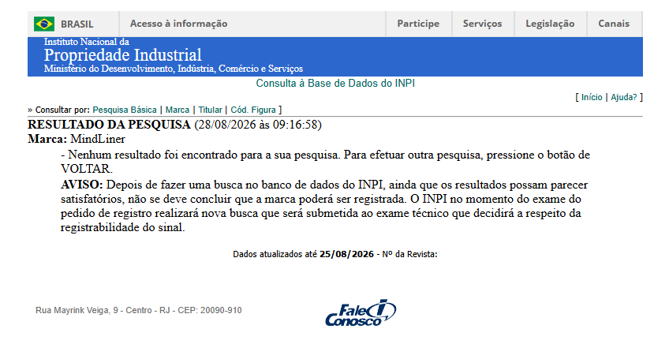
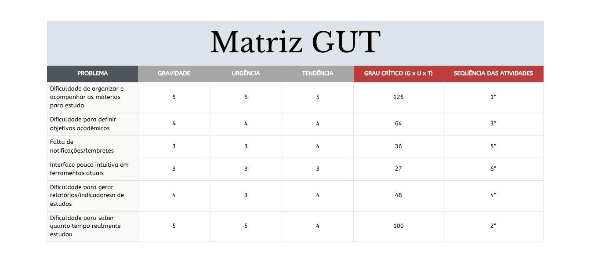

# INPI e Matriz GUT

> Página gerada a partir de [`INPI e Matriz GUT.docx`](../../Documenta%C3%A7%C3%A3o%20de%20Gest%C3%A3o%20-%20Mercado/INPI%20e%20Matriz%20GUT.docx) para leitura no GitHub. O arquivo original continua sendo a fonte oficial: edite o original e rode `python3 scripts/docs/gerar_docs.py`.

[⬅ Voltar ao sumário](../README.md)

## INPI

O registro do MindLiner será realizado estrategicamente na Classe 09 do INPI, pois o produto é fundamentalmente um software focado em auxiliar estudantes na gestão do tempo de estudo e na organização de mapas e planos de estudo. Esse enquadramento garante a proteção jurídica da marca no mercado de tecnologia, impedindo que concorrentes lancem ferramentas com nomes semelhantes nas lojas de aplicativos (como Google Play e App Store). Dessa forma, asseguramos a exclusividade de uso da marca no nosso ambiente de atuação, prevenindo a concorrência desleal e evitando que o público estudante confunda nossa solução com outras plataformas.

## Matriz GUT

A Matriz GUT será aplicada na etapa de identificação e priorização dos problemas relacionados ao contexto de utilização do MindLiner. A escolha desse ponto é estratégica, pois o sistema foi desenvolvido com o objetivo de solucionar dificuldades identificadas em relação aos estudos e, portanto, é necessário estabelecer quais problemas apresentam maior impacto e devem ser tratados com prioridade.

