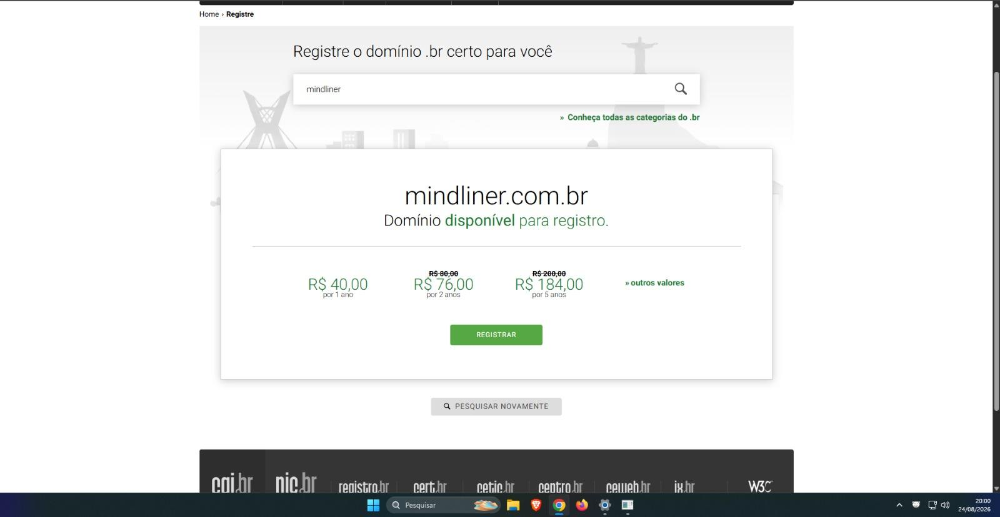
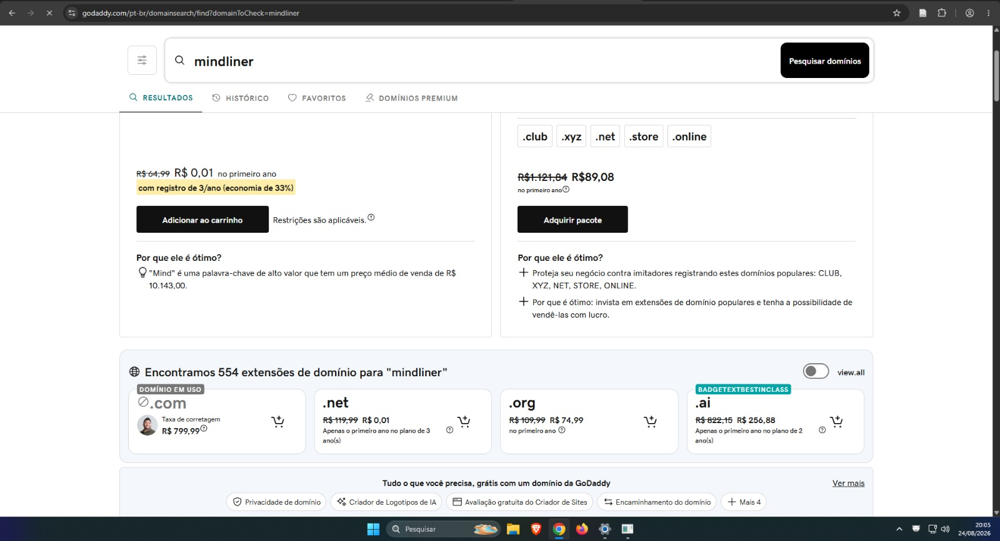
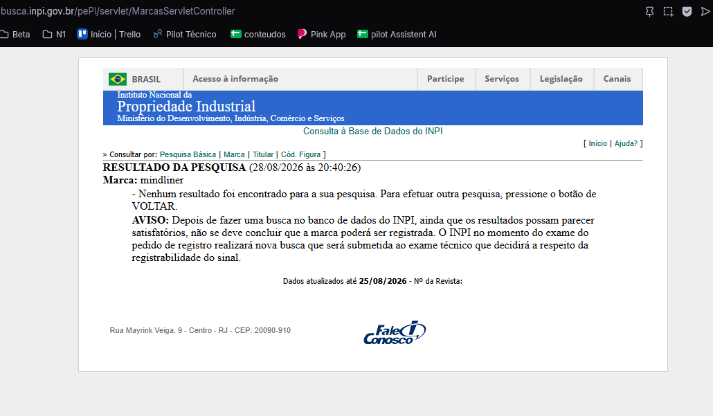
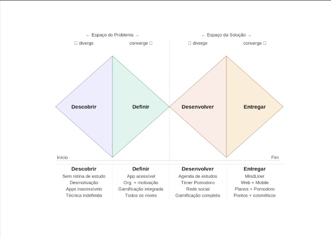
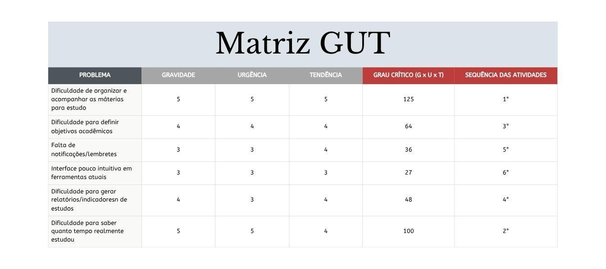

# Pesquisa de Mercado e Aplicação de Ferramentas

> Página gerada a partir de [`MindLiner — Pesquisa de Mercado e Aplicação de Ferramentas.docx`](../../Documenta%C3%A7%C3%A3o%20de%20Gest%C3%A3o%20-%20Mercado/MindLiner%20%E2%80%94%20Pesquisa%20de%20Mercado%20e%20Aplica%C3%A7%C3%A3o%20de%20Ferramentas.docx) para leitura no GitHub. O arquivo original continua sendo a fonte oficial: edite o original e rode `python3 scripts/docs/gerar_docs.py`.

[⬅ Voltar para Gestão e mercado](../README.md#1-gestão-e-mercado) · [Sumário geral](../README.md)

## Sumário

- [Organização do documento](#organização-do-documento)
- [1. Apresentação do projeto](#1-apresentação-do-projeto)
- [2. Pesquisa e definição de domínios](#2-pesquisa-e-definição-de-domínios)
  - [2.1 Domínio nacional — Registro.br](#21-domínio-nacional--registrobr)
  - [2.2 Domínio internacional — GoDaddy](#22-domínio-internacional--godaddy)
- [3. Pesquisa de viabilidade da marca no INPI](#3-pesquisa-de-viabilidade-da-marca-no-inpi)
- [4. Mapeamento do Código de Defesa do Consumidor](#4-mapeamento-do-código-de-defesa-do-consumidor)
  - [1. Usuários e Autenticação](#1-usuários-e-autenticação)
  - [2. Gerenciamento de Estudos](#2-gerenciamento-de-estudos)
  - [3. Controle de Tempo](#3-controle-de-tempo)
  - [4. Técnicas de Estudo](#4-técnicas-de-estudo)
  - [5. Gamificação](#5-gamificação)
  - [6. Grupos de Estudo](#6-grupos-de-estudo)
  - [7. Monitoramento e Relatórios](#7-monitoramento-e-relatórios)
  - [8. Inteligência Artificial](#8-inteligência-artificial)
  - [9. Notificações](#9-notificações)
  - [10. Foco e Controle de Distrações](#10-foco-e-controle-de-distrações)
  - [11. Personalização e Acessibilidade](#11-personalização-e-acessibilidade)
  - [12. Compras e Pagamentos](#12-compras-e-pagamentos)
  - [14. Termos de Uso e Contratos](#14-termos-de-uso-e-contratos)
  - [15. Administração e Loja](#15-administração-e-loja)
- [5. Mapeamento da Lei Geral de Proteção de Dados](#5-mapeamento-da-lei-geral-de-proteção-de-dados)
  - [Medidas de proteção e retenção](#medidas-de-proteção-e-retenção)
- [6. Análise SWOT — pontos fortes e oportunidades](#6-análise-swot--pontos-fortes-e-oportunidades)
- [7. Duplo Diamante](#7-duplo-diamante)
- [8. Matriz GUT](#8-matriz-gut)
- [9. Matriz RACI](#9-matriz-raci)
- [10. Análise complementar de mercado e concorrentes](#10-análise-complementar-de-mercado-e-concorrentes)
  - [Sinais de mercado](#sinais-de-mercado)
  - [Concorrentes de produto](#concorrentes-de-produto)
  - [Conclusão integrada](#conclusão-integrada)

**UNICESUMAR — UNIVERSIDADE CESUMAR**

Engenharia de Software — 8º semestre

Gestão de Projetos Tecnológicos \| Prof. Cassiano Borim

Atividade de Pesquisa de Mercado  
e Aplicação de Ferramentas

MindLiner

Documento unificado das análises do projeto

Agosto de 2026

## Organização do documento

- 1\. Apresentação do projeto
- 2\. Pesquisa e definição de domínios
- 3\. Pesquisa de viabilidade da marca no INPI
- 4\. Mapeamento do Código de Defesa do Consumidor
- 5\. Mapeamento da LGPD
- 6\. Análise SWOT \| pontos fortes e oportunidades
- 7\. Duplo Diamante
- 8\. Matriz GUT
- 9\. Matriz RACI
- 10\. Análise complementar de mercado e concorrentes
- Anexo A. Termos de Uso e Política de Privacidade

## 1. Apresentação do projeto

O MindLiner é uma plataforma de apoio aos estudos voltada à organização, ao foco e à motivação. A solução prevê aplicação web em React, aplicação mobile em React Native, backend em Java e banco de dados PostgreSQL. Entre as funcionalidades definidas estão planos de estudo, técnica Pomodoro integrada, sistema de pontos e personalização de personagem com itens cosméticos.

As análises reunidas a seguir atendem aos blocos solicitados na atividade de Pesquisa de Mercado e aplicação de ferramentas, mantendo o conteúdo produzido pela equipe e organizando-o em uma sequência única para leitura e correção.

## 2. Pesquisa e definição de domínios

### 2.1 Domínio nacional — Registro.br

**Domínio definido:** mindliner.com.br

A escolha mantém correspondência direta com o nome do produto, facilita a memorização e reforça a identificação nacional da plataforma. O domínio .com.br também transmite familiaridade ao público brasileiro, definido como mercado inicial do projeto. Na consulta registrada pela equipe, o endereço aparecia disponível para registro.

***Figura 1 — Consulta do domínio mindliner.com.br no Registro.br, realizada pela equipe em 24/08/2026.***

### 2.2 Domínio internacional — GoDaddy

**Domínio definido:** mindliner.net

A extensão .net é reconhecida internacionalmente e mantém relação com produtos digitais e serviços on-line. Ela foi escolhida como alternativa viável ao domínio .com, que aparecia em uso e sujeito a serviço de intermediação na consulta. A definição preserva o nome da marca e permite futura comunicação fora do Brasil.

***Figura 2 — Consulta internacional no GoDaddy. O resultado mostra o .com em uso e alternativas de extensão, incluindo .net.***

## 3. Pesquisa de viabilidade da marca no INPI

***Figura 3 — Pesquisa da marca “mindliner” na base do INPI em 28/08/2026, sem resultado encontrado.***

A consulta não encontrou resultado para a expressão pesquisada. Conforme o próprio aviso exibido pelo INPI, esse resultado não garante, por si só, que a marca poderá ser registrada, pois o pedido ainda depende de nova busca e exame técnico de registrabilidade.

O registro do MindLiner será realizado estrategicamente na Classe 09 do INPI, pois o produto é fundamentalmente um software focado em auxiliar estudantes na gestão do tempo de estudo e na organização de mapas e planos de estudo. Esse enquadramento garante a proteção jurídica da marca no mercado de tecnologia, impedindo que concorrentes lancem ferramentas com nomes semelhantes nas lojas de aplicativos (como Google Play e App Store). Dessa forma, asseguramos a exclusividade de uso da marca no nosso ambiente de atuação, prevenindo a concorrência desleal e evitando que o público estudante confunda nossa solução com outras plataformas.

## 4. Mapeamento do Código de Defesa do Consumidor

A seguir, o mapeamento produzido pela equipe é apresentado de forma integral, com reorganização apenas de títulos e espaçamentos para integração ao documento.

A aplicação do Código de Defesa do Consumidor (CDC) ao sistema deve ser analisada de acordo com a natureza de cada agrupamento funcional. Considerando que a plataforma oferece serviços digitais de estudo e também possibilita a aquisição de conteúdos e recursos pagos, as principais obrigações estão relacionadas à transparência, qualidade e adequação do serviço, cumprimento da oferta, proteção contra práticas abusivas, contratação eletrônica e proteção dos direitos do consumidor.

O CDC considera consumidor aquele que adquire ou utiliza um produto ou serviço como destinatário final (Art. 2º) e fornecedor aquele que presta ou comercializa produtos e serviços no mercado de consumo (Art. 3º). Como o sistema disponibiliza serviços digitais e recursos mediante remuneração, esses dispositivos fundamentam a existência da relação de consumo.

O mapeamento foi realizado conforme agrupamento dos requisitos disponíveis até o momento e definidos pela equipe. Foi utilizado como base o Código de Defesa do Consumidor (CDC. Fonte: BRASIL. Lei nº 8.078, de 11 de setembro de 1990 — Código de Defesa do Consumidor. Texto compilado. Presidência da República, Casa Civil. Planalto

O texto compilado utilizado contempla as alterações de novas leis, apresentando sua versão vigente conforme o Governo Federal.

### 1. Usuários e Autenticação

Este agrupamento contempla o cadastro, autenticação, recuperação de acesso, gerenciamento das informações do usuário e encerramento da conta.

**Art. 6º, III — Direito à informação.**

O consumidor possui direito à informação adequada e clara sobre os produtos e serviços, incluindo suas características, qualidade, preço e eventuais riscos.

Para a plataforma, isso significa que o usuário deve compreender, de maneira acessível, as condições de utilização do serviço, especialmente quando o cadastro estiver relacionado a funcionalidades pagas ou à aceitação de termos contratuais.

**Art. 43 — Dados e cadastros.**

O consumidor possui direito de acesso às informações existentes em cadastros e registros mantidos sobre ele, além da possibilidade de exigir a correção de informações inexatas.

Esse artigo possui relação com o gerenciamento das informações da conta. Entretanto, os aspectos específicos de tratamento, correção, eliminação e proteção de dados pessoais devem ser complementados pela LGPD.

### 2. Gerenciamento de Estudos

Este agrupamento compreende o gerenciamento de disciplinas, conteúdos, roteiros, metas, sessões, histórico e progresso dos estudos.

**Art. 6º, III — Informação adequada e clara.**

As características e condições do serviço devem ser apresentadas de forma compreensível ao consumidor.

**Art. 14 — Responsabilidade pelo serviço.**

O fornecedor de serviços responde, independentemente de culpa, pelos danos causados por defeitos relativos à prestação do serviço ou por informações insuficientes ou inadequadas sobre sua utilização e riscos.

Assim, quando determinada funcionalidade fizer parte do serviço oferecido ao consumidor, espera-se que seja disponibilizada de maneira compatível com aquilo que foi apresentado.

**Art. 20 — Vícios na prestação do serviço.**

O dispositivo trata de situações em que o serviço apresenta vícios de qualidade ou divergência em relação às informações fornecidas ao consumidor.

Aplicação ao sistema: Funcionalidades de estudo que sejam apresentadas como parte do serviço devem funcionar de maneira compatível com suas características anunciadas.

### 3. Controle de Tempo

O agrupamento contempla cronômetro, timer, início, pausa e encerramento das sessões, além da persistência e recuperação do estado da sessão.

**Art. 14 — Responsabilidade pela prestação do serviço.**

A relação ocorre principalmente porque o controle de tempo é uma funcionalidade oferecida dentro do serviço.

Caso uma falha relevante comprometa a utilização da funcionalidade ou cause perda de informações que o serviço deveria preservar, pode existir discussão sobre inadequação da prestação do serviço.

**Art. 20 — Qualidade do serviço.**

A funcionalidade deve corresponder às características e condições apresentadas ao consumidor.

Portanto, a aplicação desses artigos está relacionada principalmente à confiabilidade e adequação das funcionalidades oferecidas.

### 4. Técnicas de Estudo

O sistema disponibiliza diferentes técnicas de estudo, incluindo técnicas predefinidas e personalizadas, com parâmetros, ciclos, etapas e acompanhamento do progresso.

**Art. 6º, III — Informação**

O consumidor deve receber informações claras sobre as características do serviço.

**Art. 30 — Vinculação da oferta**

Toda informação ou publicidade suficientemente precisa sobre um produto ou serviço obriga o fornecedor e integra o contrato celebrado.

Assim, se uma determinada técnica ou funcionalidade for anunciada com características específicas, essas características devem corresponder ao que é efetivamente disponibilizado.

**Art. 31 — Informações sobre produtos e serviços**

As informações apresentadas ao consumidor devem ser corretas, claras, precisas e ostensivas.

**Art. 37 — Publicidade enganosa ou abusiva**

É proibida publicidade enganosa ou abusiva. A publicidade também pode ser considerada enganosa quando omite informação essencial capaz de induzir o consumidor ao erro.

Aplicação: a divulgação das técnicas de estudo não deve atribuir ao sistema características, resultados ou funcionalidades que ele não efetivamente oferece.

### 5. Gamificação

A gamificação compreende pontos, moedas virtuais, check-ins, medalhas, conquistas, ranking e troca de moedas por recompensas.

**Art. 6º, III — Direito à informação**

As regras relacionadas à obtenção, utilização e troca de pontos, moedas e recompensas devem ser apresentadas de maneira clara.

**Art. 30 — Vinculação da oferta**

As condições anunciadas para recompensas ou benefícios vinculam o fornecedor.

**Art. 37 — Publicidade enganosa**

As recompensas e vantagens não podem ser apresentadas de maneira que induza o consumidor a erro sobre suas características ou condições.

**Art. 39 — Práticas abusivas**

O fornecedor não pode se aproveitar da vulnerabilidade ou ignorância do consumidor para impor produtos ou serviços, nem condicionar indevidamente o fornecimento de um produto ou serviço à aquisição de outro.

Aplicação no sistema: A gamificação deve possuir regras transparentes e não pode utilizar mecanismos que levem o usuário a realizar uma aquisição mediante informação enganosa ou prática abusiva.

### 6. Grupos de Estudo

O agrupamento permite criação de grupos, ingresso e saída de participantes, visualização de integrantes, definição de privacidade, gerenciamento de membros e compartilhamento por convites.

**Art. 6º, III — Informação adequada e clara**

O usuário deve ser informado sobre as características do grupo e, principalmente, sobre as condições de privacidade e visibilidade.

**Art. 14 — Qualidade do serviço**

As funcionalidades relacionadas aos grupos devem funcionar de acordo com as características apresentadas. Por exemplo, se determinado grupo é apresentado como privado, a plataforma deve respeitar essa característica.

Observação: a proteção das informações dos participantes e o tratamento dos dados pessoais estão mais diretamente relacionados à LGPD do que ao CDC.

### 7. Monitoramento e Relatórios

O sistema disponibiliza dashboards, gráficos, indicadores e relatórios relacionados ao desempenho dos estudos.

**Art. 6º, III — Informação adequada e clara**

Os indicadores apresentados devem possuir significado compreensível para o consumidor.

**Art. 14 — Prestação adequada do serviço**

Os relatórios e indicadores oferecidos como parte do serviço devem funcionar de acordo com aquilo que foi apresentado.

**Art. 37 — Publicidade enganosa**

Caso determinados indicadores ou resultados sejam utilizados na publicidade do produto, as informações não podem induzir o consumidor a conclusões equivocadas sobre o desempenho ou as capacidades da plataforma.

### 8. Inteligência Artificial

A plataforma possui um agente de inteligência artificial que utiliza informações fornecidas pelo usuário e seu histórico de estudos para gerar recomendações e metas personalizadas.

**Art. 6º, III — Direito à informação**

O usuário deve ser informado de maneira clara sobre as características relevantes do serviço de IA, incluindo sua finalidade e, quando necessário, suas limitações.

**Art. 14 — Responsabilidade pelo serviço**

Caso a IA seja apresentada como uma funcionalidade do serviço, sua operação deve ser compatível com aquilo que foi informado ao consumidor

**Art. 37 — Publicidade enganosa**

A plataforma não deve atribuir à inteligência artificial capacidades que ela não possui ou apresentar suas recomendações de maneira que possa induzir o consumidor a acreditar que determinado resultado acadêmico é garantido.

Como a IA utiliza informações pessoais e histórico de estudos, a análise deve ser complementada pela LGPD, especialmente quanto à transparência e ao tratamento dos dados.

### 9. Notificações

O sistema permite configurar preferências e ativar ou desativar notificações.

**Art. 6º, III — Informação**

O usuário deve saber a finalidade das notificações recebidas.

**Art. 37 — Publicidade**

Quando as notificações tiverem finalidade comercial ou promocional, seu conteúdo deve observar as regras de publicidade do CDC.

**Art. 39, III — Serviço não solicitado**

O CDC veda o fornecimento de produto ou serviço sem solicitação prévia do consumidor. Por isso, é importante diferenciar notificações necessárias ao funcionamento do serviço de comunicações comerciais.

### 10. Foco e Controle de Distrações

O sistema permite configurar aplicativos para bloqueio e identificar a abertura desses aplicativos durante uma sessão de estudo.

**Art. 6º, III — Informação adequada e clara**

O usuário deve ser informado sobre como o mecanismo funciona e sobre eventuais limitações.

**Art. 14 — Responsabilidade pelo serviço**

A funcionalidade deve funcionar de acordo com as características apresentadas ao consumidor. Assim, se houver limitações técnicas — por exemplo, determinados aplicativos ou situações que não possam ser bloqueadas — essa informação deve ser apresentada de forma adequada.

### 11. Personalização e Acessibilidade

O sistema permite personalização visual, modo claro e escuro, cores, ícones, GIFs e filtros de acessibilidade.

**Art. 6º, III — Informação**

O usuário deve conhecer as características das opções de personalização disponibilizadas.

**Art. 30 — Vinculação da oferta**

Quando determinada opção de personalização for apresentada como característica do serviço ou como benefício de determinada oferta, ela deve ser disponibilizada nas condições anunciadas.

**Art. 31 — Informação correta e precisa**

As descrições das funcionalidades devem corresponder ao seu comportamento real.

### 12. Compras e Pagamentos

Este é o agrupamento com maior incidência direta do CDC, pois envolve aquisição de recursos pagos, meios de pagamento, confirmação de transações, comprovantes e histórico de compras.

**Art. 6º, III — Informação**

O consumidor deve receber informações claras sobre:

- Produto ou recurso;
- Características;
- Preço;
- Condições de pagamento;
- Restrições aplicáveis.

**Art. 30 — Vinculação da oferta**

A oferta apresentada ao consumidor integra a relação contratual.

**Art. 31 — Informações sobre o produto ou serviço**

As informações devem ser corretas, claras, precisas e ostensivas.

**Art. 35 — Descumprimento da oferta**

Caso o fornecedor recuse o cumprimento da oferta, o consumidor pode, conforme sua escolha e as hipóteses legais, exigir seu cumprimento, aceitar prestação equivalente ou rescindir o contrato com restituição dos valores pagos e eventuais perdas e danos.

**Art. 42 — Cobrança indevida**

O consumidor não pode ser exposto a constrangimento na cobrança, e o CDC prevê, nas hipóteses estabelecidas no artigo, restituição em dobro do valor cobrado indevidamente.

**Art. 49 — Direito de arrependimento**

Nas contratações realizadas fora do estabelecimento comercial, o consumidor pode desistir do contrato no prazo de 7 dias, nas condições estabelecidas pelo artigo, com devolução dos valores pagos.

#### 13. Contratação Eletrônica

Como a aquisição dos recursos ocorre por meio digital, além do CDC deve ser considerado o Decreto nº 7.962/2013, que regulamenta a contratação no comércio eletrônico.

**Decreto nº 7.962/2013 — Art. 2º**

Estabelece informações que devem estar disponíveis no ambiente eletrônico, como identificação do fornecedor, características essenciais do produto ou serviço, preço, condições da oferta e restrições aplicáveis.

**Decreto nº 7.962/2013 — Art. 4º**

Determina mecanismos que facilitem a contratação, incluindo:

- Apresentação de resumo do contrato;
- Possibilidade de correção de erros antes da conclusão;
- Confirmação imediata da aceitação;
- Disponibilização do contrato ao consumidor;
- Mecanismos de segurança para pagamento e tratamento dos dados.

**Decreto nº 7.962/2013 — Art. 5º**

Trata do exercício do direito de arrependimento nas contratações eletrônicas.

Portanto, a compra não deve ser tratada somente como uma operação de pagamento: Existe todo um processo de contratação eletrônica que precisa fornecer informação, confirmação, segurança e mecanismos de cancelamento.

### 14. Termos de Uso e Contratos

Os Termos de Uso estabelecem as condições de utilização da plataforma e, quando houver relação de consumo, estão sujeitos às regras de proteção contratual do CDC.

**Art. 46 — Conhecimento prévio do contrato**

O consumidor não fica obrigado por contrato cujo conteúdo não tenha podido conhecer previamente ou cuja redação dificulte sua compreensão.

**Art. 47 — Interpretação favorável**

As cláusulas contratuais devem ser interpretadas da maneira mais favorável ao consumidor.

**Art. 51 — Cláusulas abusivas**

São nulas cláusulas que, entre outras hipóteses:

- Eliminem ou reduzam indevidamente a responsabilidade do fornecedor;
- Retirem direitos de reembolso previstos no CDC;
- Imponham desvantagem exagerada ao consumidor;
- Permitam alteração unilateral do preço;
- Permitam alteração unilateral do conteúdo ou qualidade do contrato após sua celebração.

**Art. 54 — Contratos de adesão**

É relevante porque os Termos de Uso de uma plataforma normalmente são apresentados ao usuário de forma padronizada, sem negociação individual das cláusulas.

### 15. Administração e Loja

O backoffice permite que administradores cadastrem, editem, inativam e definam preços dos itens oferecidos na loja.

**Art. 30 — Vinculação da oferta**

A condição apresentada ao consumidor integra a relação contratual.

**Art. 35 — Descumprimento da oferta**

O consumidor possui os direitos previstos quando a oferta não é cumprida.

**Art. 51, X e XIII — Alterações unilaterais**

O CDC considera abusivas cláusulas que permitam ao fornecedor variar unilateralmente o preço ou modificar unilateralmente o conteúdo ou a qualidade do contrato após sua celebração.

Isso é particularmente relevante para a loja: Alterações administrativas podem valer para novas compras, mas não devem modificar arbitrariamente condições já contratadas pelo consumidor.

## 5. Mapeamento da Lei Geral de Proteção de Dados

A política elaborada pela equipe foi organizada abaixo conforme os quatro pontos solicitados na atividade. O texto integral dos Termos de Uso e da Política de Privacidade está preservado no Anexo A.

| **Requisito**            | **Mapeamento definido pela equipe**                                                                                                                                                                                                                                              |
|--------------------------|----------------------------------------------------------------------------------------------------------------------------------------------------------------------------------------------------------------------------------------------------------------------------------|
| **Dados captados**       | Idade; sexo; nível de escolaridade; tempo de estudo semanal, mensal e anual; registros de atividades; registros de transações internas; pontos obtidos; itens virtuais adquiridos; e informações necessárias ao funcionamento das funcionalidades.                               |
| **Dados armazenados**    | Os dados pessoais serão mantidos pelo período necessário para cumprir as finalidades informadas. Quando não houver mais necessidade ou fundamento legal, poderão ser eliminados ou anonimizados.                                                                                 |
| **Dados compartilhados** | Poderá haver parceria com empresas do setor educacional para cursos, materiais, promoções, ofertas, convites e serviços compatíveis com os interesses do usuário. O compartilhamento deve ser limitado à finalidade e aos dados necessários, com informação adequada ao titular. |
| **Uso comercial**        | Para usuários maiores de idade, o uso de dados para métricas, análises comerciais ou publicidade será opcional e dependerá de escolha informada. A recusa não impede o uso das funcionalidades essenciais, e o consentimento poderá ser revogado.                                |

### Medidas de proteção e retenção

- Controle de acesso e de permissões
- Autenticação e proteção de credenciais
- Criptografia quando aplicável
- Monitoramento de acessos e backups
- Restrição de acesso e procedimentos de resposta a incidentes

As medidas devem ser consideradas desde a concepção do produto e observar a adoção de salvaguardas técnicas e administrativas contra acessos não autorizados e situações acidentais ou ilícitas.

## 6. Análise SWOT — pontos fortes e oportunidades

Conforme o recorte solicitado na atividade, esta seção apresenta os pontos fortes e as oportunidades identificados para o MindLiner.

| **PONTOS FORTES**                                                                               | **OPORTUNIDADES**                                                                                                 |
|-------------------------------------------------------------------------------------------------|-------------------------------------------------------------------------------------------------------------------|
| • Proposta de valor integrada: planejar, focar, registrar e acompanhar o estudo no mesmo fluxo. | • Posicionamento brasileiro e localizado em uma categoria dominada por soluções fragmentadas ou globais.          |
| • Combinação coerente de timer, técnicas de estudo, gamificação, grupos e progresso.            | • Busca orgânica acessível: vários termos relevantes têm KD entre 0 e 3 no recorte fornecido.                     |
| • Recuperação de sessão interrompida pode resolver um problema real de continuidade.            | • ENEM e concursos formam um segmento inicial com dor, calendário e intenção de busca claros.                     |
| • Presença web e mobile aumenta alcance e permite aquisição por conteúdo.                       | • IA baseada no histórico pode adaptar planos e sugerir o próximo passo com mais contexto que chatbots genéricos. |
| • Stack adequada ao objetivo: Java, React Native/Expo e PostgreSQL.                             | • Parcerias com escolas, cursinhos, professores e criadores podem reduzir custo de aquisição.                     |
| • Atenção documentada a privacidade, acessibilidade e aspectos legais.                          | • Privacidade, acessibilidade, ausência de anúncios e segurança para estudantes podem fortalecer confiança.       |

## 7. Duplo Diamante

Ferramenta de processo que divide o desenvolvimento em quatro fases, alternando entre pensamento divergente (explorar) e convergente (decidir).

**Descobrir — levantamento amplo do problema:** estudantes sem rotina de estudos, desmotivação, apps inacessíveis e ausência de técnica definida.

**Definir — afunilamento da solução:** app acessível que une organização de estudos, motivação por gamificação e integração da técnica Pomodoro, voltado para estudantes de todos os níveis.

**Desenvolver — exploração de alternativas:** agenda de estudos simples, timer Pomodoro isolado, rede social de estudos, gamificação completa. A gamificação integrada foi a alternativa escolhida.

**Entregar — solução definida:** MindLiner — plataforma web (React) e mobile (React Native) com backend Java e PostgreSQL, oferecendo planos de estudo, Pomodoro integrado, sistema de pontos e personalização de personagem com itens cosméticos.

***Figura 4 — Aplicação do Duplo Diamante ao desenvolvimento do MindLiner.***

## 8. Matriz GUT

A Matriz GUT será aplicada na etapa de identificação e priorização dos problemas relacionados ao contexto de utilização do MindLiner. A escolha desse ponto é estratégica, pois o sistema foi desenvolvido com o objetivo de solucionar dificuldades identificadas em relação aos estudos e, portanto, é necessário estabelecer quais problemas apresentam maior impacto e devem ser tratados com prioridade.

***Figura 5 — Matriz GUT elaborada pela equipe para priorização dos problemas do projeto.***

A maior prioridade é a dificuldade de organizar e acompanhar as matérias para estudo (125 pontos), seguida da dificuldade para saber quanto tempo o estudante realmente estudou (100 pontos).

## 9. Matriz RACI

Legenda: R = Responsável pela execução; A = Responsável final pela aprovação; C = Consultado; I = Informado.

| **Tarefa / etapa**                                           | **PO** | **Scrum Master** | **Designer** | **Dev BackEnd** | **Dev FrontEnd** | **Usuários** |
|--------------------------------------------------------------|--------|------------------|--------------|-----------------|------------------|--------------|
| 1\. Definir Casos de Uso e Backlog (Ex: UC-01 a UC-71)       | R/A    | I                | I            | C               | C                | C            |
| 2\. Definir Arquitetura e Decisões Técnicas (ADRs)           | A      | I                | I            | R               | R                | I            |
| 3\. Desenhar Telas (App e Web) e Identidade Visual           | A      | I                | R            | I               | C                | C            |
| 4\. Desenvolver a API Backend (PostgreSQL + Java)            | A      | I                | I            | R               | C                | I            |
| 5\. Desenvolver Aplicação Mobile (React Native)              | A      | I                | C            | C               | R                | I            |
| 6\. Desenvolver Módulos Nativos (Modo Foco/Bloqueio)         | A      | I                | I            | R               | R                | I            |
| 7\. Integrar Gamificação e Pagamentos (UC-31 a UC-37, UC-68) | A      | I                | I            | R               | R                | I            |
| 8\. Realizar Testes de Funcionalidade (Review)               | A      | C                | C            | C               | C                | R            |
| 9\. Implantar e Disponibilizar (Deploy)                      | A      | C                | I            | R               | R                | I            |

## 10. Análise complementar de mercado e concorrentes

O MindLiner entra em uma categoria concorrida, mas ainda fragmentada. Tudy, NoEstudo e Aprovado são referências brasileiras próximas; YPT e Study Bunny mostram padrões de escala em foco social e gamificação. A oportunidade de diferenciação está em combinar organização, foco e retomada do plano com uma experiência brasileira, acessível e segura.

### Sinais de mercado

| **Indicador**               | **Resultado**                                                        | **Leitura**                                                                     |
|-----------------------------|----------------------------------------------------------------------|---------------------------------------------------------------------------------|
| Volume relevante do recorte | 8.580 buscas/mês                                                     | Existe demanda, concentrada em poucos termos principais e muitas caudas longas. |
| Histórico de 24 meses       | 3.792/mês nos últimos 12 meses vs. 3.781 no período anterior (+0,3%) | Mercado estável no agregado, com sazonalidade mais importante que crescimento.  |
| Termo líder                 | “plano de estudos”: 2.400 buscas/mês; KD 1; TP 3.300                 | Melhor tema-pilar para aquisição e demonstração do produto.                     |

### Concorrentes de produto

| **Concorrente**     | **Força principal**                                                                                | **Resposta recomendada**                                                                  |
|---------------------|----------------------------------------------------------------------------------------------------|-------------------------------------------------------------------------------------------|
| **Tudy**            | Amplitude de matérias, cadernos, prazos, Pomodoro, times, estatísticas, flashcards e gamificação.  | Ser mais simples no início e superior em retomada e recomendação baseada no histórico.    |
| **NoEstudo**        | Cronograma, métricas, revisão espaçada, IA adaptativa e relatórios.                                | Unir plano adaptativo a foco em tempo real e explicar cada ajuste sugerido.               |
| **Aprovado**        | Timer, metas, planejamento, histórico, gráficos e revisões; forte reconhecimento em provas.        | Demonstrar ganho de aderência ao plano, não apenas registro de horas.                     |
| **YPT / Yeolpumta** | Timer por matéria, bloqueio de apps, planner, grupos, ranking e estatísticas; grande escala móvel. | Diferenciar por localização brasileira, privacidade, segurança e orientação pedagógica.   |
| **Study Bunny**     | Personagem, moedas, loja, tarefas, flashcards e acompanhamento; forte apelo emocional.             | Construir motivação sem infantilizar todo o público e permitir camadas de personalização. |

### Conclusão integrada

O conjunto das análises sustenta a viabilidade conceitual do MindLiner e indica como prioridade o fluxo central de organização, foco, registro e retomada do estudo. Domínio, marca, requisitos legais, priorização e responsabilidades estão mapeados. O diferencial precisa ser demonstrado na prática pela aderência do estudante ao plano, com gamificação integrada como apoio à motivação.

---

[⬅ Voltar para Gestão e mercado](../README.md#1-gestão-e-mercado) · [Sumário geral](../README.md) · [↑ Topo da página](#)
