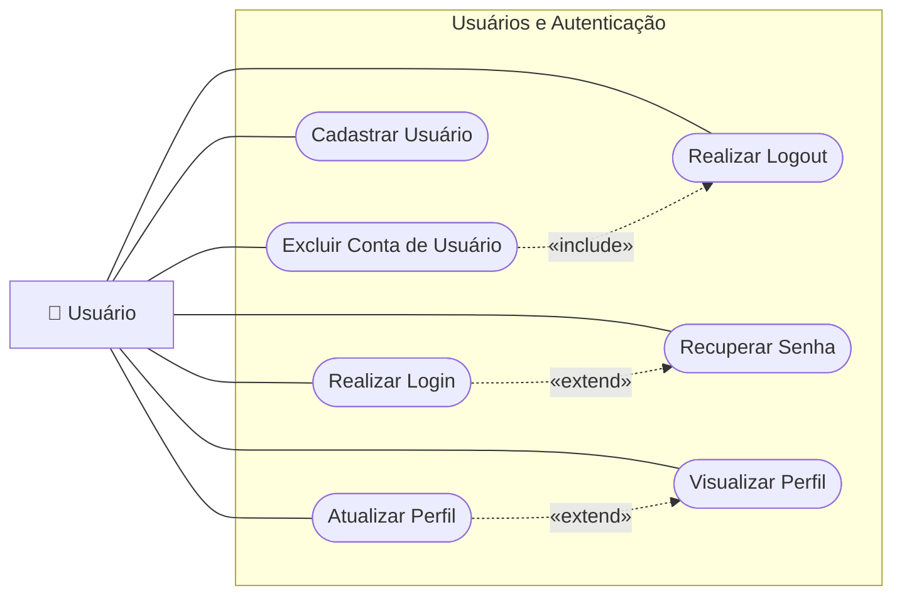
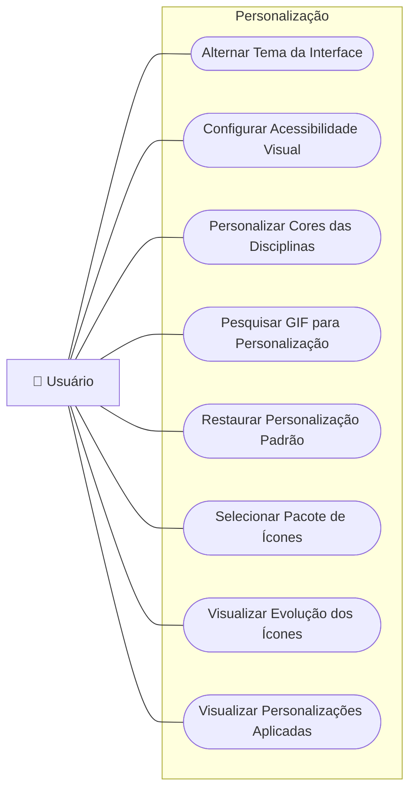
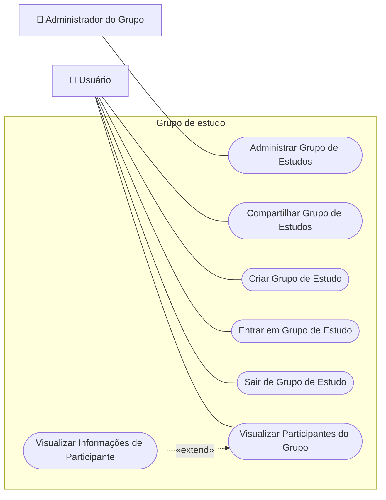
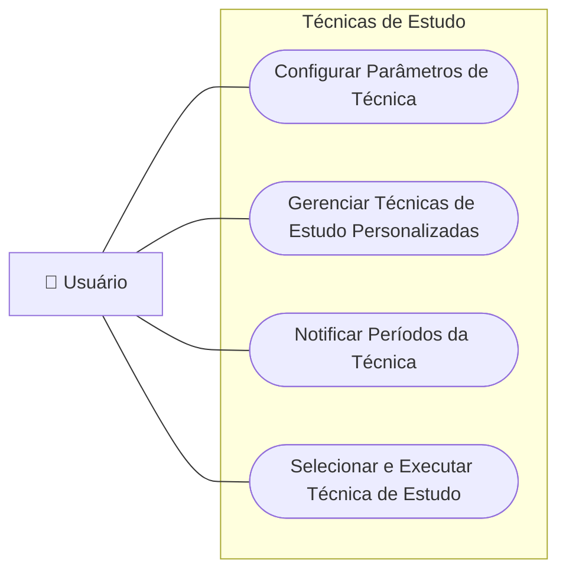
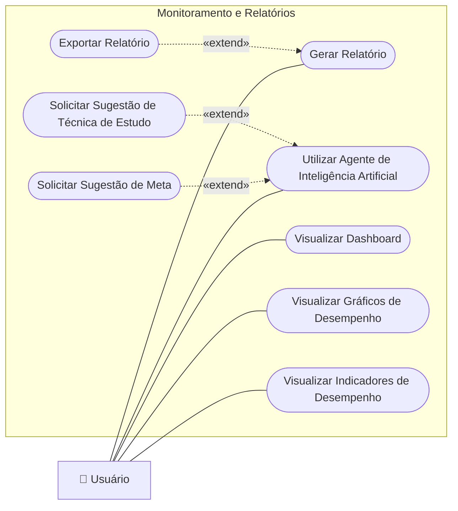
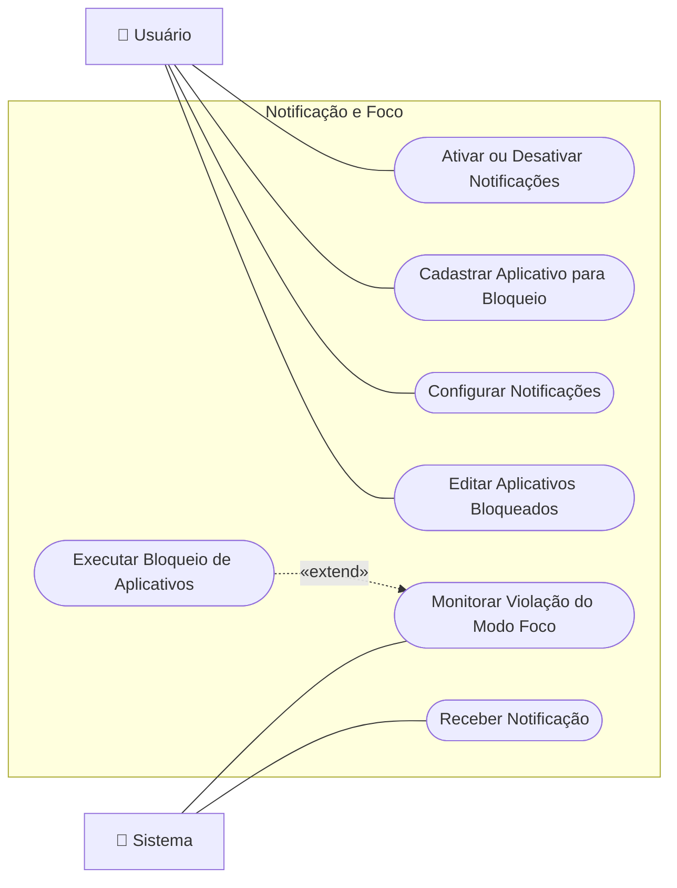
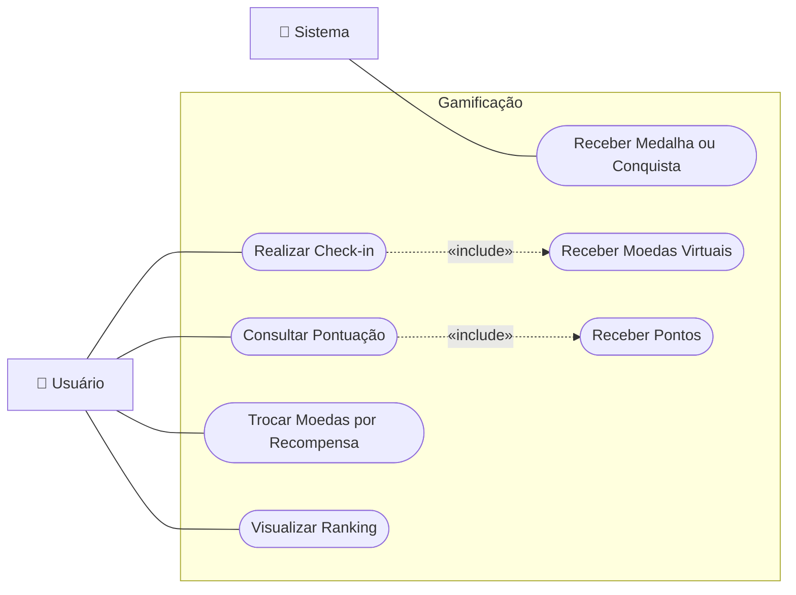
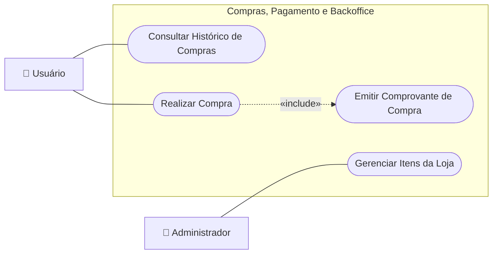
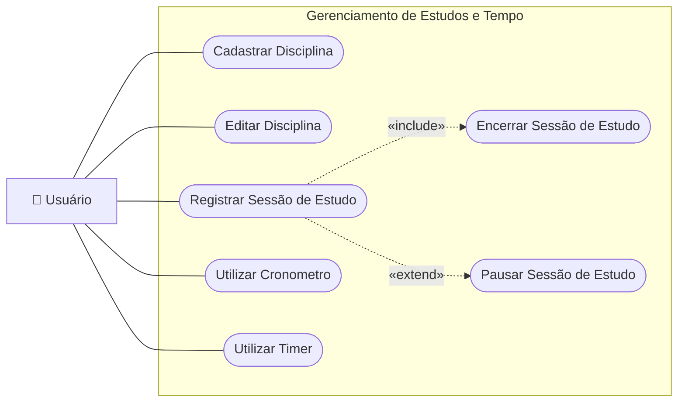

# Diagrama de Casos de Uso

> Página gerada a partir de [`Caso de uso`](../../Documentos%20de%20Diagramas/Caso%20de%20uso) para leitura no GitHub. O arquivo original continua sendo a fonte oficial: edite o original e rode `python3 scripts/docs/gerar_docs.py`.
>
> Para ver o desenho original, com o layout do draw.io: [abrir no visualizador do draw.io](https://viewer.diagrams.net/?nav=1&lightbox=1#Uhttps%3A%2F%2Fraw.githubusercontent.com%2Fbialemesvsouza%2FEquipe-Escola-TI%2Fmain%2FDocumentos%2520de%2520Diagramas%2FCaso%2520de%2520uso) (só leitura) ou abra o arquivo no [app.diagrams.net](https://app.diagrams.net) / extensão Draw.io do VS Code. O arquivo `Caso de uso` não tem extensão, mas é um diagrama do draw.io.

[⬅ Voltar para Diagramas](../README.md#3-diagramas) · [Sumário geral](../README.md)

**59 casos de uso**, **4 atores** (Administrador, Administrador do Grupo, Sistema, Usuário) em **9 pacotes**.

Legenda: linha cheia = ator participa do caso de uso · tracejada `«include»` = sempre executa o outro · tracejada `«extend»` = pode executar o outro.

O detalhamento de cada caso de uso (fluxos, pré e pós-condições) está em [Casos de Uso detalhados](casos-de-uso.md).

## Sumário

- [Usuários e Autenticação](#usuários-e-autenticação)
- [Personalização](#personalização)
- [Grupo de estudo](#grupo-de-estudo)
- [Técnicas de Estudo](#técnicas-de-estudo)
- [Monitoramento e Relatórios](#monitoramento-e-relatórios)
- [Notificação e Foco](#notificação-e-foco)
- [Gamificação](#gamificação)
- [Compras, Pagamento e Backoffice](#compras-pagamento-e-backoffice)
- [Gerenciamento de Estudos e Tempo](#gerenciamento-de-estudos-e-tempo)
- [Lista completa](#lista-completa)

## Usuários e Autenticação

## Personalização

## Grupo de estudo

## Técnicas de Estudo

## Monitoramento e Relatórios

## Notificação e Foco

## Gamificação

## Compras, Pagamento e Backoffice

## Gerenciamento de Estudos e Tempo

## Lista completa

| Pacote | Caso de uso | Atores | Relações |
|---|---|---|---|
| Usuários e Autenticação | Cadastrar Usuário | Usuário | — |
| Usuários e Autenticação | Realizar Login | Usuário | «extend» Recuperar Senha |
| Usuários e Autenticação | Realizar Logout | Usuário | — |
| Usuários e Autenticação | Recuperar Senha | Usuário | — |
| Usuários e Autenticação | Atualizar Perfil | Usuário | «extend» Visualizar Perfil |
| Usuários e Autenticação | Visualizar Perfil | Usuário | — |
| Usuários e Autenticação | Excluir Conta de Usuário | Usuário | «include» Realizar Logout |
| Personalização | Visualizar Evolução dos Ícones | Usuário | — |
| Personalização | Restaurar Personalização Padrão | Usuário | — |
| Personalização | Pesquisar GIF para Personalização | Usuário | — |
| Personalização | Visualizar Personalizações Aplicadas | Usuário | — |
| Personalização | Selecionar Pacote de Ícones | Usuário | — |
| Personalização | Personalizar Cores das Disciplinas | Usuário | — |
| Personalização | Alternar Tema da Interface | Usuário | — |
| Personalização | Configurar Acessibilidade Visual | Usuário | — |
| Grupo de estudo | Criar Grupo de Estudo | Usuário | — |
| Grupo de estudo | Entrar em Grupo de Estudo | Usuário | — |
| Grupo de estudo | Sair de Grupo de Estudo | Usuário | — |
| Grupo de estudo | Compartilhar Grupo de Estudos | Usuário | — |
| Grupo de estudo | Administrar Grupo de Estudos | Administrador do Grupo | — |
| Grupo de estudo | Visualizar Informações de Participante | — | «extend» Visualizar Participantes do Grupo |
| Grupo de estudo | Visualizar Participantes do Grupo | Usuário | — |
| Técnicas de Estudo | Selecionar e Executar Técnica de Estudo | Usuário | — |
| Técnicas de Estudo | Configurar Parâmetros de Técnica | Usuário | — |
| Técnicas de Estudo | Notificar Períodos da Técnica | Usuário | — |
| Técnicas de Estudo | Gerenciar Técnicas de Estudo Personalizadas | Usuário | — |
| Monitoramento e Relatórios | Visualizar Dashboard | Usuário | — |
| Monitoramento e Relatórios | Visualizar Gráficos de Desempenho | Usuário | — |
| Monitoramento e Relatórios | Visualizar Indicadores de Desempenho | Usuário | — |
| Monitoramento e Relatórios | Gerar Relatório | Usuário | — |
| Monitoramento e Relatórios | Exportar Relatório | — | «extend» Gerar Relatório |
| Monitoramento e Relatórios | Utilizar Agente de Inteligência Artificial | Usuário | — |
| Monitoramento e Relatórios | Solicitar Sugestão de Técnica de Estudo | — | «extend» Utilizar Agente de Inteligência Artificial |
| Monitoramento e Relatórios | Solicitar Sugestão de Meta | — | «extend» Utilizar Agente de Inteligência Artificial |
| Notificação e Foco | Configurar Notificações | Usuário | — |
| Notificação e Foco | Ativar ou Desativar Notificações | Usuário | — |
| Notificação e Foco | Receber Notificação | Sistema | — |
| Notificação e Foco | Monitorar Violação do Modo Foco | Sistema | — |
| Notificação e Foco | Executar Bloqueio de Aplicativos | — | «extend» Monitorar Violação do Modo Foco |
| Notificação e Foco | Editar Aplicativos Bloqueados | Usuário | — |
| Notificação e Foco | Cadastrar Aplicativo para Bloqueio | Usuário | — |
| Gamificação | Receber Pontos | — | — |
| Gamificação | Receber Moedas Virtuais | — | — |
| Gamificação | Receber Medalha ou Conquista | Sistema | — |
| Gamificação | Consultar Pontuação | Usuário | «include» Receber Pontos |
| Gamificação | Realizar Check-in | Usuário | «include» Receber Moedas Virtuais |
| Gamificação | Visualizar Ranking | Usuário | — |
| Gamificação | Trocar Moedas por Recompensa | Usuário | — |
| Compras, Pagamento e Backoffice | Realizar Compra | Usuário | «include» Emitir Comprovante de Compra |
| Compras, Pagamento e Backoffice | Consultar Histórico de Compras | Usuário | — |
| Compras, Pagamento e Backoffice | Emitir Comprovante de Compra | — | — |
| Compras, Pagamento e Backoffice | Gerenciar Itens da Loja | Administrador | — |
| Gerenciamento de Estudos e Tempo | Cadastrar Disciplina | Usuário | — |
| Gerenciamento de Estudos e Tempo | Editar Disciplina | Usuário | — |
| Gerenciamento de Estudos e Tempo | Registrar Sessão de Estudo | Usuário | «extend» Pausar Sessão de Estudo «include» Encerrar Sessão de Estudo |
| Gerenciamento de Estudos e Tempo | Pausar Sessão de Estudo | — | — |
| Gerenciamento de Estudos e Tempo | Encerrar Sessão de Estudo | — | — |
| Gerenciamento de Estudos e Tempo | Utilizar Cronometro | Usuário | — |
| Gerenciamento de Estudos e Tempo | Utilizar Timer | Usuário | — |

---

[⬅ Voltar para Diagramas](../README.md#3-diagramas) · [Sumário geral](../README.md) · [↑ Topo da página](#)
