# Diagrama de Classes

> Página gerada a partir de [`Diagrama_De_Classe_Atualizado.drawio`](../../Documentos%20de%20Diagramas/Diagrama_De_Classe_Atualizado.drawio) para leitura no GitHub. O arquivo original continua sendo a fonte oficial: edite o original e rode `python3 scripts/docs/gerar_docs.py`.
>
> Para ver o desenho original, com o layout do draw.io: [abrir no visualizador do draw.io](https://viewer.diagrams.net/?nav=1&lightbox=1#Uhttps%3A%2F%2Fraw.githubusercontent.com%2Fbialemesvsouza%2FEquipe-Escola-TI%2Fmain%2FDocumentos%2520de%2520Diagramas%2FDiagrama_De_Classe_Atualizado.drawio) (só leitura) ou abra o arquivo no [app.diagrams.net](https://app.diagrams.net) / extensão Draw.io do VS Code.

[⬅ Voltar ao sumário](../README.md)

**51 classes** em **10 módulos** e **62 relacionamentos**.

Legenda: `*--` composição · `o--` agregação · `-->` associação · `<|--` herança. Os números são as multiplicidades.

## Sumário

- [Visão geral (classes e relacionamentos)](#visão-geral)
- [Perfil e Configurações](#perfil-e-configurações)
- [Técnicas de Estudo](#técnicas-de-estudo)
- [Estudo e Sessões](#estudo-e-sessões)
- [Planejamento](#planejamento)
- [Gamificação](#gamificação)
- [Loja e Inventário](#loja-e-inventário)
- [Compras e Pagamentos](#compras-e-pagamentos)
- [Grupos de Estudo](#grupos-de-estudo)
- [Monitoramento e Relatórios](#monitoramento-e-relatórios)
- [Inteligência Artificial](#inteligência-artificial)

## Visão geral

Todas as classes, só com os nomes, para enxergar como os módulos se ligam. Os atributos e métodos estão nas seções de cada módulo.

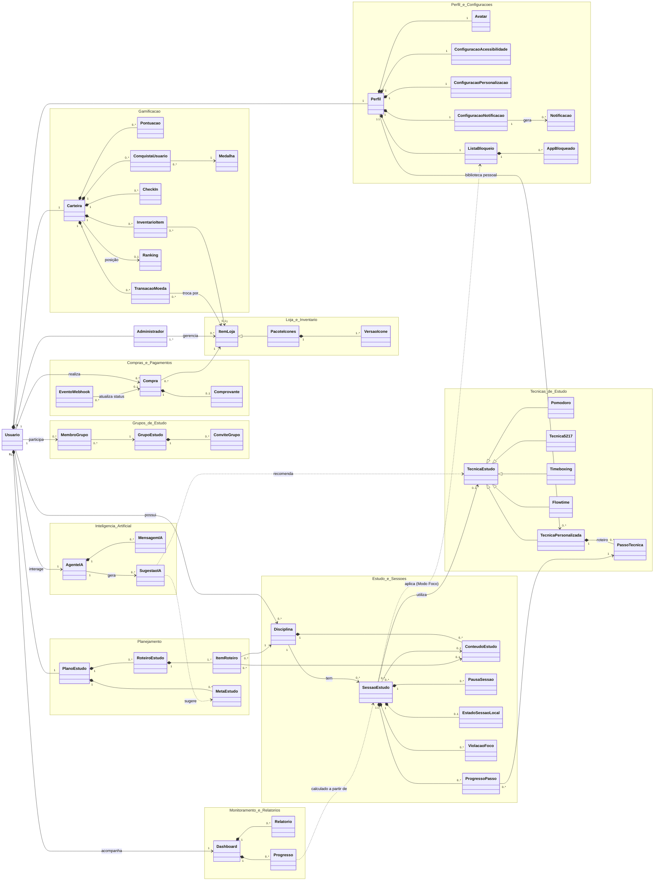

## Perfil e Configurações

Classes do módulo: `Perfil`, `Avatar`, `ConfiguracaoAcessibilidade`, `ConfiguracaoPersonalizacao`, `ConfiguracaoNotificacao`, `Notificacao`, `ListaBloqueio`, `AppBloqueado`.

Ligações com outros módulos: `SessaoEstudo`, `TecnicaPersonalizada`, `Usuario` (aparecem sem detalhes).

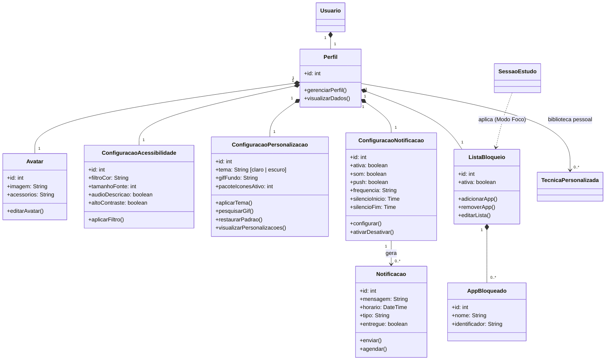

Atributos e métodos em texto

**Perfil**

| Atributos | Métodos |
|---|---|
| `+ id: int` | `+ gerenciarPerfil()` |
|  | `+ visualizarDados()` |

**Avatar**

| Atributos | Métodos |
|---|---|
| `+ id: int` | `+ editarAvatar()` |
| `+ imagem: String` |  |
| `+ acessorios: String` |  |

**ConfiguracaoAcessibilidade**

| Atributos | Métodos |
|---|---|
| `+ id: int` | `+ aplicarFiltro()` |
| `+ filtroCor: String` |  |
| `+ tamanhoFonte: int` |  |
| `+ audioDescricao: boolean` |  |
| `+ altoContraste: boolean` |  |

**ConfiguracaoPersonalizacao**

| Atributos | Métodos |
|---|---|
| `+ id: int` | `+ aplicarTema()` |
| `+ tema: String (claro | escuro)` | `+ pesquisarGif()` |
| `+ gifFundo: String` | `+ restaurarPadrao()` |
| `+ pacoteIconesAtivo: int` | `+ visualizarPersonalizacoes()` |

**ConfiguracaoNotificacao**

| Atributos | Métodos |
|---|---|
| `+ id: int` | `+ configurar()` |
| `+ ativa: boolean` | `+ ativarDesativar()` |
| `+ som: boolean` |  |
| `+ push: boolean` |  |
| `+ frequencia: String` |  |
| `+ silencioInicio: Time` |  |
| `+ silencioFim: Time` |  |

**Notificacao**

| Atributos | Métodos |
|---|---|
| `+ id: int` | `+ enviar()` |
| `+ mensagem: String` | `+ agendar()` |
| `+ horario: DateTime` |  |
| `+ tipo: String` |  |
| `+ entregue: boolean` |  |

**ListaBloqueio**

| Atributos | Métodos |
|---|---|
| `+ id: int` | `+ adicionarApp()` |
| `+ ativa: boolean` | `+ removerApp()` |
|  | `+ editarLista()` |

**AppBloqueado**

| Atributos | Métodos |
|---|---|
| `+ id: int` |  |
| `+ nome: String` |  |
| `+ identificador: String` |  |

## Técnicas de Estudo

Classes do módulo: `TecnicaEstudo`, `Pomodoro`, `Tecnica5217`, `Timeboxing`, `Flowtime`, `TecnicaPersonalizada`, `PassoTecnica`.

Ligações com outros módulos: `Perfil`, `ProgressoPasso`, `SessaoEstudo`, `SugestaoIA` (aparecem sem detalhes).

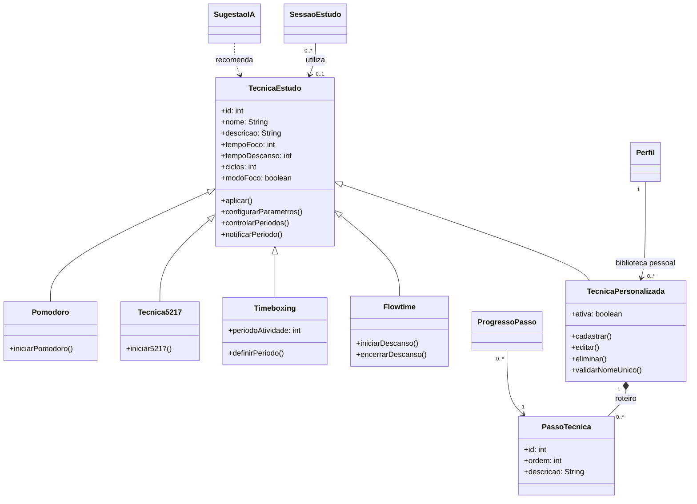

Atributos e métodos em texto

**TecnicaEstudo**

| Atributos | Métodos |
|---|---|
| `+ id: int` | `+ aplicar()` |
| `+ nome: String` | `+ configurarParametros()` |
| `+ descricao: String` | `+ controlarPeriodos()` |
| `+ tempoFoco: int` | `+ notificarPeriodo()` |
| `+ tempoDescanso: int` |  |
| `+ ciclos: int` |  |
| `+ modoFoco: boolean` |  |

**Pomodoro**

| Atributos | Métodos |
|---|---|
|  | `+ iniciarPomodoro()` |

**Tecnica5217**

| Atributos | Métodos |
|---|---|
|  | `+ iniciar5217()` |

**Timeboxing**

| Atributos | Métodos |
|---|---|
| `+ periodoAtividade: int` | `+ definirPeriodo()` |

**Flowtime**

| Atributos | Métodos |
|---|---|
|  | `+ iniciarDescanso()` |
|  | `+ encerrarDescanso()` |

**TecnicaPersonalizada**

| Atributos | Métodos |
|---|---|
| `+ ativa: boolean` | `+ cadastrar()` |
|  | `+ editar()` |
|  | `+ eliminar()` |
|  | `+ validarNomeUnico()` |

**PassoTecnica**

| Atributos | Métodos |
|---|---|
| `+ id: int` |  |
| `+ ordem: int` |  |
| `+ descricao: String` |  |

## Estudo e Sessões

Classes do módulo: `Disciplina`, `ConteudoEstudo`, `SessaoEstudo`, `PausaSessao`, `EstadoSessaoLocal`, `ViolacaoFoco`, `ProgressoPasso`.

Ligações com outros módulos: `ItemRoteiro`, `ListaBloqueio`, `PassoTecnica`, `Progresso`, `TecnicaEstudo`, `Usuario` (aparecem sem detalhes).

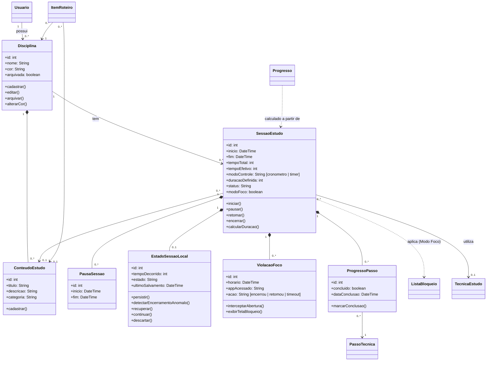

Atributos e métodos em texto

**Disciplina**

| Atributos | Métodos |
|---|---|
| `+ id: int` | `+ cadastrar()` |
| `+ nome: String` | `+ editar()` |
| `+ cor: String` | `+ arquivar()` |
| `+ arquivada: boolean` | `+ alterarCor()` |

**ConteudoEstudo**

| Atributos | Métodos |
|---|---|
| `+ id: int` | `+ cadastrar()` |
| `+ titulo: String` |  |
| `+ descricao: String` |  |
| `+ categoria: String` |  |

**SessaoEstudo**

| Atributos | Métodos |
|---|---|
| `+ id: int` | `+ iniciar()` |
| `+ inicio: DateTime` | `+ pausar()` |
| `+ fim: DateTime` | `+ retomar()` |
| `+ tempoTotal: int` | `+ encerrar()` |
| `+ tempoEfetivo: int` | `+ calcularDuracao()` |
| `+ modoControle: String (cronometro | timer)` |  |
| `+ duracaoDefinida: int` |  |
| `+ status: String` |  |
| `+ modoFoco: boolean` |  |

**PausaSessao**

| Atributos | Métodos |
|---|---|
| `+ id: int` |  |
| `+ inicio: DateTime` |  |
| `+ fim: DateTime` |  |

**EstadoSessaoLocal**

| Atributos | Métodos |
|---|---|
| `+ id: int` | `+ persistir()` |
| `+ tempoDecorrido: int` | `+ detectarEncerramentoAnomalo()` |
| `+ estado: String` | `+ recuperar()` |
| `+ ultimoSalvamento: DateTime` | `+ continuar()` |
|  | `+ descartar()` |

**ViolacaoFoco**

| Atributos | Métodos |
|---|---|
| `+ id: int` | `+ interceptarAbertura()` |
| `+ horario: DateTime` | `+ exibirTelaBloqueio()` |
| `+ appAcessado: String` |  |
| `+ acao: String (encerrou | retomou | timeout)` |  |

**ProgressoPasso**

| Atributos | Métodos |
|---|---|
| `+ id: int` | `+ marcarConclusao()` |
| `+ concluido: boolean` |  |
| `+ dataConclusao: DateTime` |  |

## Planejamento

Classes do módulo: `PlanoEstudo`, `RoteiroEstudo`, `ItemRoteiro`, `MetaEstudo`.

Ligações com outros módulos: `ConteudoEstudo`, `Disciplina`, `SugestaoIA`, `Usuario` (aparecem sem detalhes).

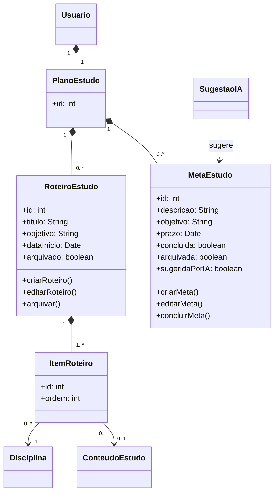

Atributos e métodos em texto

**PlanoEstudo**

| Atributos | Métodos |
|---|---|
| `+ id: int` |  |

**RoteiroEstudo**

| Atributos | Métodos |
|---|---|
| `+ id: int` | `+ criarRoteiro()` |
| `+ titulo: String` | `+ editarRoteiro()` |
| `+ objetivo: String` | `+ arquivar()` |
| `+ dataInicio: Date` |  |
| `+ arquivado: boolean` |  |

**ItemRoteiro**

| Atributos | Métodos |
|---|---|
| `+ id: int` |  |
| `+ ordem: int` |  |

**MetaEstudo**

| Atributos | Métodos |
|---|---|
| `+ id: int` | `+ criarMeta()` |
| `+ descricao: String` | `+ editarMeta()` |
| `+ objetivo: String` | `+ concluirMeta()` |
| `+ prazo: Date` |  |
| `+ concluida: boolean` |  |
| `+ arquivada: boolean` |  |
| `+ sugeridaPorIA: boolean` |  |

## Gamificação

Classes do módulo: `Carteira`, `Pontuacao`, `TransacaoMoeda`, `CheckIn`, `ConquistaUsuario`, `Medalha`, `Ranking`, `InventarioItem`.

Ligações com outros módulos: `ItemLoja`, `Usuario` (aparecem sem detalhes).

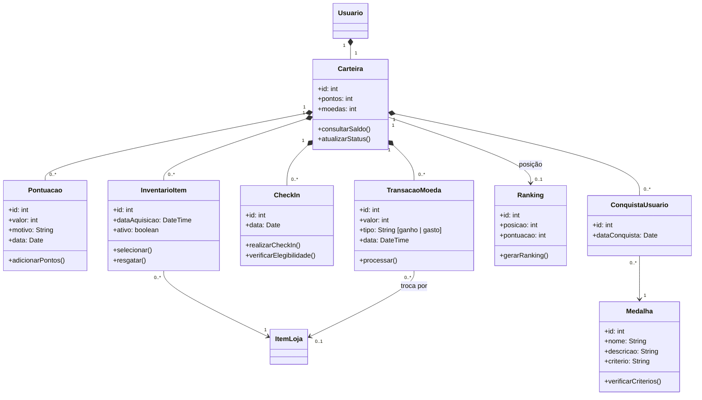

Atributos e métodos em texto

**Carteira**

| Atributos | Métodos |
|---|---|
| `+ id: int` | `+ consultarSaldo()` |
| `+ pontos: int` | `+ atualizarStatus()` |
| `+ moedas: int` |  |

**Pontuacao**

| Atributos | Métodos |
|---|---|
| `+ id: int` | `+ adicionarPontos()` |
| `+ valor: int` |  |
| `+ motivo: String` |  |
| `+ data: Date` |  |

**TransacaoMoeda**

| Atributos | Métodos |
|---|---|
| `+ id: int` | `+ processar()` |
| `+ valor: int` |  |
| `+ tipo: String (ganho | gasto)` |  |
| `+ data: DateTime` |  |

**CheckIn**

| Atributos | Métodos |
|---|---|
| `+ id: int` | `+ realizarCheckIn()` |
| `+ data: Date` | `+ verificarElegibilidade()` |

**ConquistaUsuario**

| Atributos | Métodos |
|---|---|
| `+ id: int` |  |
| `+ dataConquista: Date` |  |

**Medalha**

| Atributos | Métodos |
|---|---|
| `+ id: int` | `+ verificarCriterios()` |
| `+ nome: String` |  |
| `+ descricao: String` |  |
| `+ criterio: String` |  |

**Ranking**

| Atributos | Métodos |
|---|---|
| `+ id: int` | `+ gerarRanking()` |
| `+ posicao: int` |  |
| `+ pontuacao: int` |  |

**InventarioItem**

| Atributos | Métodos |
|---|---|
| `+ id: int` | `+ selecionar()` |
| `+ dataAquisicao: DateTime` | `+ resgatar()` |
| `+ ativo: boolean` |  |

## Loja e Inventário

Classes do módulo: `ItemLoja`, `PacoteIcones`, `VersaoIcone`.

Ligações com outros módulos: `Administrador`, `Compra`, `InventarioItem`, `TransacaoMoeda` (aparecem sem detalhes).

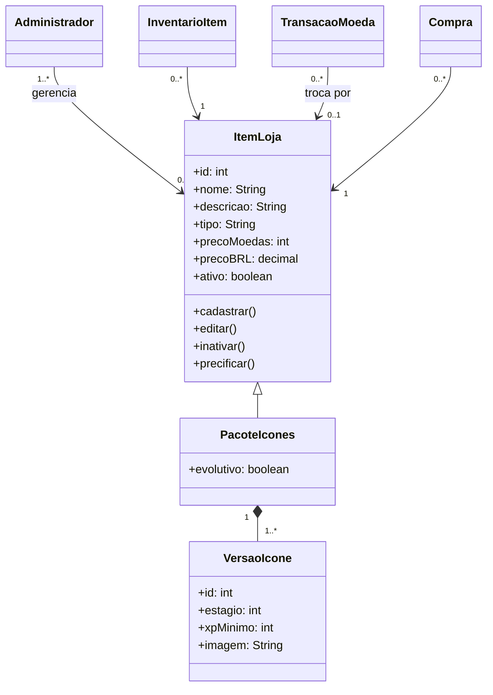

Atributos e métodos em texto

**ItemLoja**

| Atributos | Métodos |
|---|---|
| `+ id: int` | `+ cadastrar()` |
| `+ nome: String` | `+ editar()` |
| `+ descricao: String` | `+ inativar()` |
| `+ tipo: String` | `+ precificar()` |
| `+ precoMoedas: int` |  |
| `+ precoBRL: decimal` |  |
| `+ ativo: boolean` |  |

**PacoteIcones**

| Atributos | Métodos |
|---|---|
| `+ evolutivo: boolean` |  |

**VersaoIcone**

| Atributos | Métodos |
|---|---|
| `+ id: int` |  |
| `+ estagio: int` |  |
| `+ xpMinimo: int` |  |
| `+ imagem: String` |  |

## Compras e Pagamentos

Classes do módulo: `Compra`, `Comprovante`, `EventoWebhook`.

Ligações com outros módulos: `ItemLoja`, `Usuario` (aparecem sem detalhes).

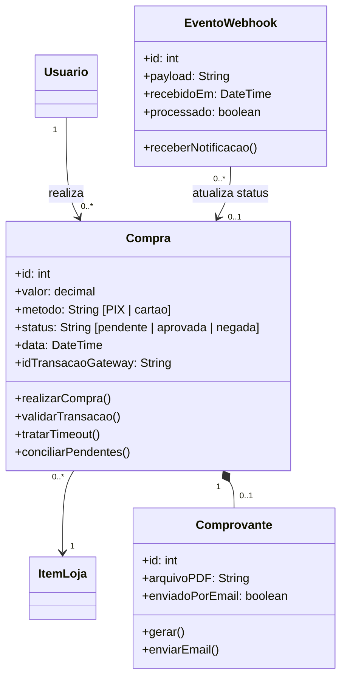

Atributos e métodos em texto

**Compra**

| Atributos | Métodos |
|---|---|
| `+ id: int` | `+ realizarCompra()` |
| `+ valor: decimal` | `+ validarTransacao()` |
| `+ metodo: String (PIX | cartao)` | `+ tratarTimeout()` |
| `+ status: String (pendente | aprovada | negada)` | `+ conciliarPendentes()` |
| `+ data: DateTime` |  |
| `+ idTransacaoGateway: String` |  |

**Comprovante**

| Atributos | Métodos |
|---|---|
| `+ id: int` | `+ gerar()` |
| `+ arquivoPDF: String` | `+ enviarEmail()` |
| `+ enviadoPorEmail: boolean` |  |

**EventoWebhook**

| Atributos | Métodos |
|---|---|
| `+ id: int` | `+ receberNotificacao()` |
| `+ payload: String` |  |
| `+ recebidoEm: DateTime` |  |
| `+ processado: boolean` |  |

## Grupos de Estudo

Classes do módulo: `MembroGrupo`, `GrupoEstudo`, `ConviteGrupo`.

Ligações com outros módulos: `Usuario` (aparecem sem detalhes).

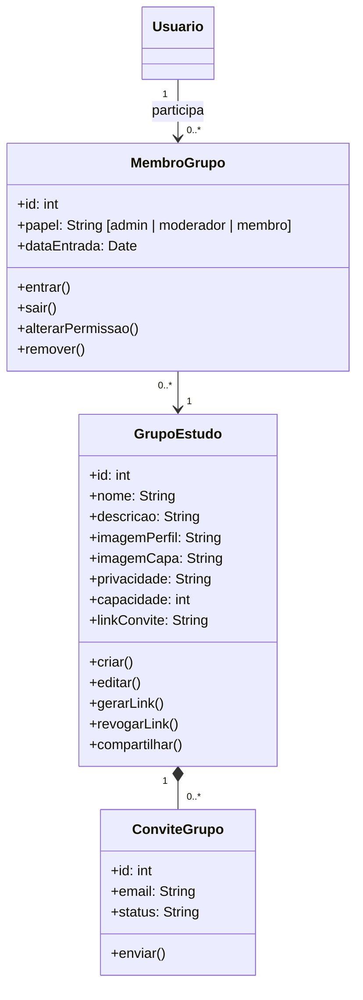

Atributos e métodos em texto

**MembroGrupo**

| Atributos | Métodos |
|---|---|
| `+ id: int` | `+ entrar()` |
| `+ papel: String (admin | moderador | membro)` | `+ sair()` |
| `+ dataEntrada: Date` | `+ alterarPermissao()` |
|  | `+ remover()` |

**GrupoEstudo**

| Atributos | Métodos |
|---|---|
| `+ id: int` | `+ criar()` |
| `+ nome: String` | `+ editar()` |
| `+ descricao: String` | `+ gerarLink()` |
| `+ imagemPerfil: String` | `+ revogarLink()` |
| `+ imagemCapa: String` | `+ compartilhar()` |
| `+ privacidade: String` |  |
| `+ capacidade: int` |  |
| `+ linkConvite: String` |  |

**ConviteGrupo**

| Atributos | Métodos |
|---|---|
| `+ id: int` | `+ enviar()` |
| `+ email: String` |  |
| `+ status: String` |  |

## Monitoramento e Relatórios

Classes do módulo: `Dashboard`, `Relatorio`, `Progresso`.

Ligações com outros módulos: `SessaoEstudo`, `Usuario` (aparecem sem detalhes).

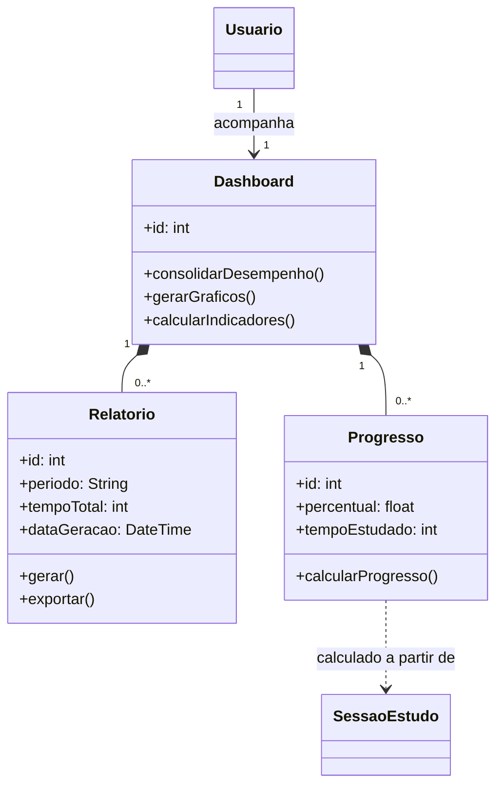

Atributos e métodos em texto

**Dashboard**

| Atributos | Métodos |
|---|---|
| `+ id: int` | `+ consolidarDesempenho()` |
|  | `+ gerarGraficos()` |
|  | `+ calcularIndicadores()` |

**Relatorio**

| Atributos | Métodos |
|---|---|
| `+ id: int` | `+ gerar()` |
| `+ periodo: String` | `+ exportar()` |
| `+ tempoTotal: int` |  |
| `+ dataGeracao: DateTime` |  |

**Progresso**

| Atributos | Métodos |
|---|---|
| `+ id: int` | `+ calcularProgresso()` |
| `+ percentual: float` |  |
| `+ tempoEstudado: int` |  |

## Inteligência Artificial

Classes do módulo: `AgenteIA`, `MensagemIA`, `SugestaoIA`.

Ligações com outros módulos: `MetaEstudo`, `TecnicaEstudo`, `Usuario` (aparecem sem detalhes).

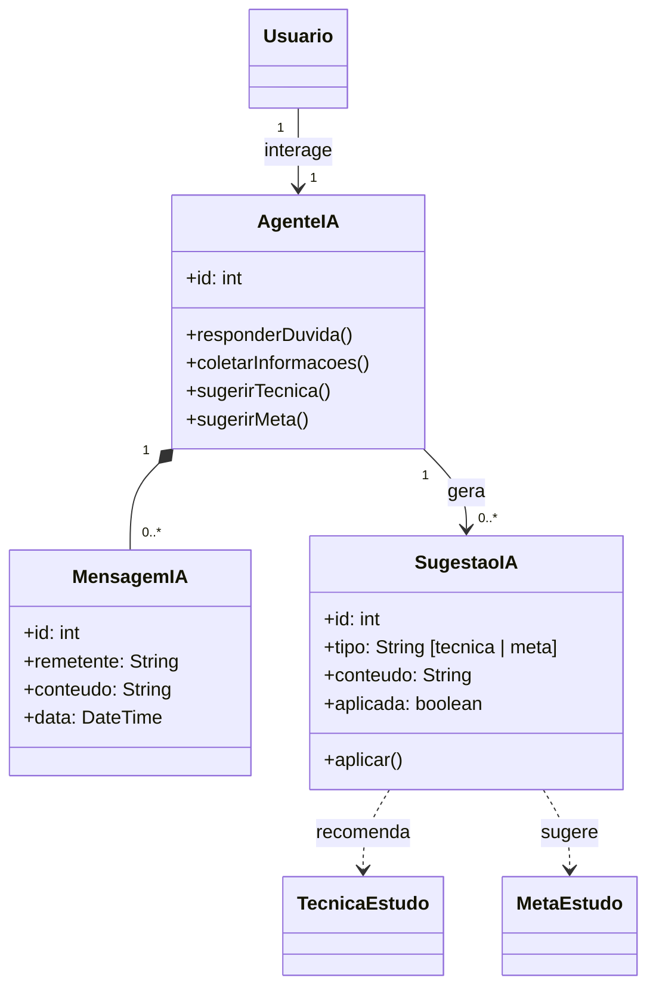

Atributos e métodos em texto

**AgenteIA**

| Atributos | Métodos |
|---|---|
| `+ id: int` | `+ responderDuvida()` |
|  | `+ coletarInformacoes()` |
|  | `+ sugerirTecnica()` |
|  | `+ sugerirMeta()` |

**MensagemIA**

| Atributos | Métodos |
|---|---|
| `+ id: int` |  |
| `+ remetente: String` |  |
| `+ conteudo: String` |  |
| `+ data: DateTime` |  |

**SugestaoIA**

| Atributos | Métodos |
|---|---|
| `+ id: int` | `+ aplicar()` |
| `+ tipo: String (tecnica | meta)` |  |
| `+ conteudo: String` |  |
| `+ aplicada: boolean` |  |

