# Diagramas de Sequência

> Página gerada a partir de [`DiagramasDeSequencia/`](../../Documentos%20de%20Diagramas/DiagramasDeSequencia) para leitura no GitHub. O arquivo original continua sendo a fonte oficial: edite o original e rode `python3 scripts/docs/gerar_docs.py`.
>
> Cada PDF cobre um grupo de **histórias de usuário** (HU001 a HU070). O nome do arquivo ("UC 1-6") segue a numeração das histórias, não a dos casos de uso. O texto de cada história está em [Histórias de Usuário](../02-requisitos/historias-de-usuario.md).

[⬅ Voltar para Diagramas](../README.md#3-diagramas) · [Sumário geral](../README.md)

## Sumário

| Arquivo | Histórias |
|---|---|
| [HU 1-6](#hu-1-6) | HU001 - Criar conta HU002 - Acessar minha conta HU003 - Recuperar acesso HU004 - Gerenciar perfil HU005 - Encerrar sessão HU006 - Excluir conta |
| [HU 7-12](#hu-7-12) | HU007 - Gerenciar disciplinas HU008 - Gerenciar conteúdos HU009 - Criar roteiros de estudo HU010 - Definir metas HU011 - Acompanhar atividades HU012 - Arquivar estudos |
| [HU 13-17](#hu-13-17) | HU013 - Iniciar sessão HU014 - Controlar sessão HU015 - Utilizar cronômetro e timer HU016 - Recuperar sessão interrompida HU017 - Persistir sessão de estudo |
| [HU 18-24](#hu-18-24) | HU018 - Escolher técnica de estudo HU019 - Configurar técnica de estudo HU020 - Utilizar técnicas disponíveis HU021 - Acompanhar etapas da técnica HU022 - Registrar progresso da técnica HU023 - Criar técnica personalizada HU024 - Gerenciar técnica personalizada |
| [HU 25-30](#hu-25-30) | HU025 — Receber pontos e moedas HU026 — Acompanhar saldo HU027 — Realizar check-in HU028 — Acompanhar conquistas HU029 — Acompanhar ranking HU030 — Resgatar recompensas |
| [HU 31-37](#hu-31-37) | HU031 — Criar grupo de estudo HU032 — Personalizar grupo HU033 — Definir privacidade do grupo HU034 — Participar de grupos HU035 — Visualizar participantes HU036 — Gerenciar participantes HU037 — Convidar pessoas |
| [HU 38-42](#hu-38-42) | HU038 — Acompanhar desempenho HU039 — Visualizar dashboard HU040 — Analisar indicadores e gráficos HU041 — Gerar relatórios HU042 — Exportar relatórios |
| [HU 43-46](#hu-43-46) | HU043 — Utilizar assistente de IA HU044 — Receber recomendações personalizadas HU045 — Receber sugestões de técnicas HU046 — Receber sugestões de metas |
| [HU 47-49](#hu-47-49) | HU047 — Configurar notificações HU048 — Ativar ou desativar notificações HU049 — Receber lembretes de estudo |
| [HU 50-53](#hu-50-53) | HU050 — Configurar aplicativos restritos HU051 — Configurar Modo Foco HU052 — Detectar distrações HU053 — Controlar acesso durante o foco |
| [HU 54-61](#hu-54-61) | HU054 — Personalizar aparência HU055 — Utilizar acessibilidade visual HU056 — Alternar tema visual HU057 — Personalizar disciplinas HU058 — Personalizar elementos visuais HU059 — Desbloquear personalizações HU060 — Restaurar personalização HU061 — Utilizar GIFs |
| [HU 62-66](#hu-62-66) | HU062 — Adquirir recursos HU063 — Realizar pagamento HU064 — Acompanhar compra HU065 — Receber comprovante HU066 — Consultar compras |
| [HU 67-70](#hu-67-70) | HU067 — Acessar área administrativa HU068 — Gerenciar itens da loja HU069 — Gerenciar preços HU070 — Gerenciar recompensas |

## HU 1-6

- HU001 - Criar conta
- HU002 - Acessar minha conta
- HU003 - Recuperar acesso
- HU004 - Gerenciar perfil
- HU005 - Encerrar sessão
- HU006 - Excluir conta

PDF original: [`UC 1-6.pdf`](../../Documentos%20de%20Diagramas/DiagramasDeSequencia/UC%201-6.pdf)

[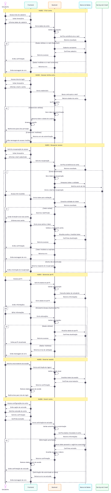](../assets/sequencia/hu-1-6.png)

_Clique na imagem para abrir em tamanho real._

## HU 7-12

- HU007 - Gerenciar disciplinas
- HU008 - Gerenciar conteúdos
- HU009 - Criar roteiros de estudo
- HU010 - Definir metas
- HU011 - Acompanhar atividades
- HU012 - Arquivar estudos

PDF original: [`UC 7-12.pdf`](../../Documentos%20de%20Diagramas/DiagramasDeSequencia/UC%207-12.pdf)

[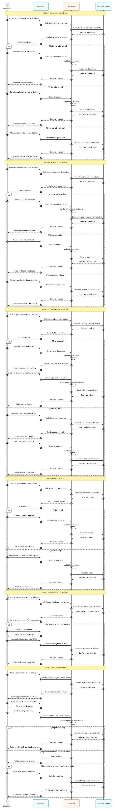](../assets/sequencia/hu-7-12.png)

_Clique na imagem para abrir em tamanho real._

## HU 13-17

- HU013 - Iniciar sessão
- HU014 - Controlar sessão
- HU015 - Utilizar cronômetro e timer
- HU016 - Recuperar sessão interrompida
- HU017 - Persistir sessão de estudo

PDF original: [`UC 13-17.pdf`](../../Documentos%20de%20Diagramas/DiagramasDeSequencia/UC%2013-17.pdf)

[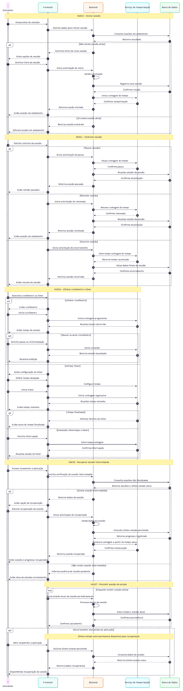](../assets/sequencia/hu-13-17.png)

_Clique na imagem para abrir em tamanho real._

## HU 18-24

- HU018 - Escolher técnica de estudo
- HU019 - Configurar técnica de estudo
- HU020 - Utilizar técnicas disponíveis
- HU021 - Acompanhar etapas da técnica
- HU022 - Registrar progresso da técnica
- HU023 - Criar técnica personalizada
- HU024 - Gerenciar técnica personalizada

PDF original: [`UC 18-24.pdf`](../../Documentos%20de%20Diagramas/DiagramasDeSequencia/UC%2018-24.pdf)

[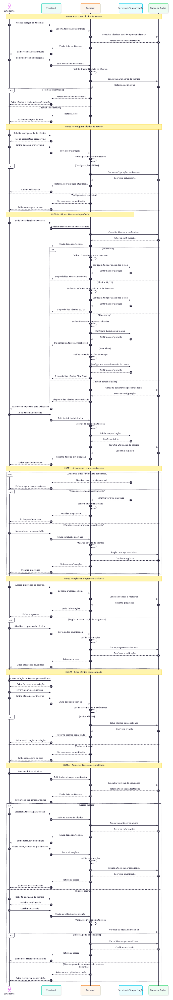](../assets/sequencia/hu-18-24.png)

_Clique na imagem para abrir em tamanho real._

## HU 25-30

- HU025 — Receber pontos e moedas
- HU026 — Acompanhar saldo
- HU027 — Realizar check-in
- HU028 — Acompanhar conquistas
- HU029 — Acompanhar ranking
- HU030 — Resgatar recompensas

PDF original: [`UC 25-30.pdf`](../../Documentos%20de%20Diagramas/DiagramasDeSequencia/UC%2025-30.pdf)

[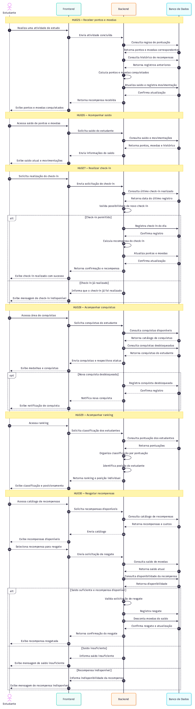](../assets/sequencia/hu-25-30.png)

_Clique na imagem para abrir em tamanho real._

## HU 31-37

- HU031 — Criar grupo de estudo
- HU032 — Personalizar grupo
- HU033 — Definir privacidade do grupo
- HU034 — Participar de grupos
- HU035 — Visualizar participantes
- HU036 — Gerenciar participantes
- HU037 — Convidar pessoas

PDF original: [`UC 31-37.pdf`](../../Documentos%20de%20Diagramas/DiagramasDeSequencia/UC%2031-37.pdf)

[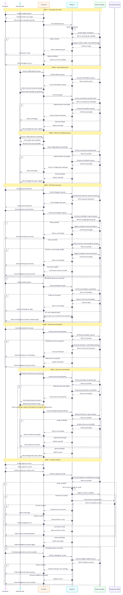](../assets/sequencia/hu-31-37.png)

_Clique na imagem para abrir em tamanho real._

## HU 38-42

- HU038 — Acompanhar desempenho
- HU039 — Visualizar dashboard
- HU040 — Analisar indicadores e gráficos
- HU041 — Gerar relatórios
- HU042 — Exportar relatórios

PDF original: [`UC 38-42.pdf`](../../Documentos%20de%20Diagramas/DiagramasDeSequencia/UC%2038-42.pdf)

[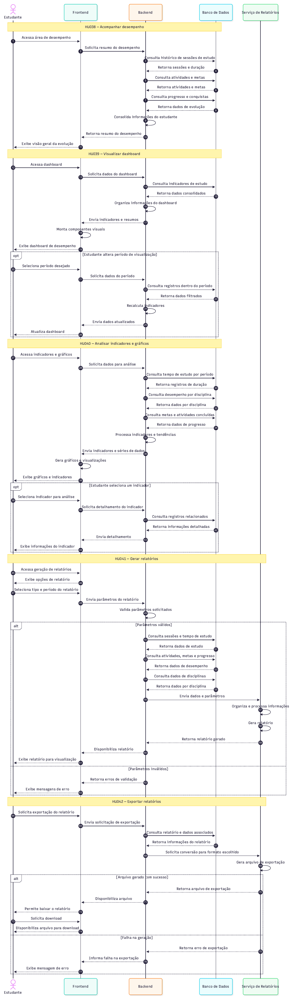](../assets/sequencia/hu-38-42.png)

_Clique na imagem para abrir em tamanho real._

## HU 43-46

- HU043 — Utilizar assistente de IA
- HU044 — Receber recomendações personalizadas
- HU045 — Receber sugestões de técnicas
- HU046 — Receber sugestões de metas

PDF original: [`UC 43-46.pdf`](../../Documentos%20de%20Diagramas/DiagramasDeSequencia/UC%2043-46.pdf)

[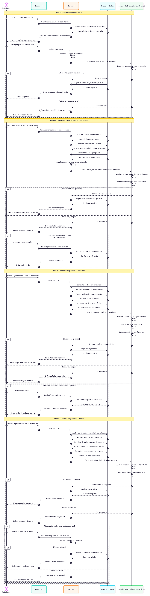](../assets/sequencia/hu-43-46.png)

_Clique na imagem para abrir em tamanho real._

## HU 47-49

- HU047 — Configurar notificações
- HU048 — Ativar ou desativar notificações
- HU049 — Receber lembretes de estudo

PDF original: [`UC 47-49.pdf`](../../Documentos%20de%20Diagramas/DiagramasDeSequencia/UC%2047-49.pdf)

[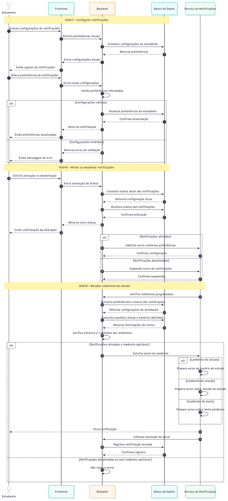](../assets/sequencia/hu-47-49.png)

_Clique na imagem para abrir em tamanho real._

## HU 50-53

- HU050 — Configurar aplicativos restritos
- HU051 — Configurar Modo Foco
- HU052 — Detectar distrações
- HU053 — Controlar acesso durante o foco

PDF original: [`UC 50-53.pdf`](../../Documentos%20de%20Diagramas/DiagramasDeSequencia/UC%2050-53.pdf)

[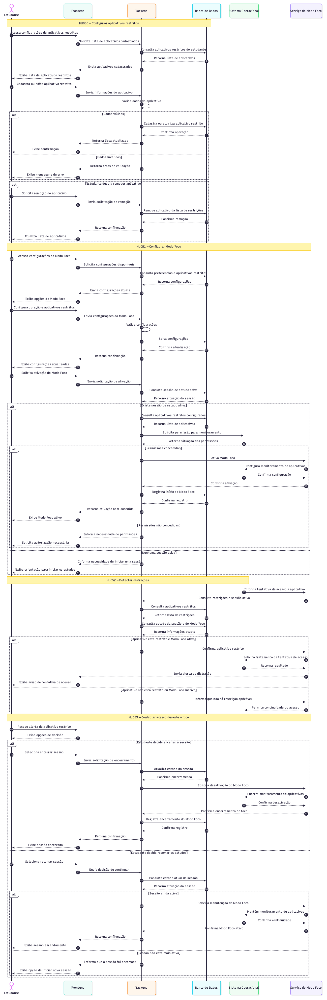](../assets/sequencia/hu-50-53.png)

_Clique na imagem para abrir em tamanho real._

## HU 54-61

- HU054 — Personalizar aparência
- HU055 — Utilizar acessibilidade visual
- HU056 — Alternar tema visual
- HU057 — Personalizar disciplinas
- HU058 — Personalizar elementos visuais
- HU059 — Desbloquear personalizações
- HU060 — Restaurar personalização
- HU061 — Utilizar GIFs

PDF original: [`UC 54-61.pdf`](../../Documentos%20de%20Diagramas/DiagramasDeSequencia/UC%2054-61.pdf)

[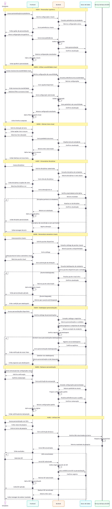](../assets/sequencia/hu-54-61.png)

_Clique na imagem para abrir em tamanho real._

## HU 62-66

- HU062 — Adquirir recursos
- HU063 — Realizar pagamento
- HU064 — Acompanhar compra
- HU065 — Receber comprovante
- HU066 — Consultar compras

PDF original: [`UC 62-66.pdf`](../../Documentos%20de%20Diagramas/DiagramasDeSequencia/UC%2062-66.pdf)

[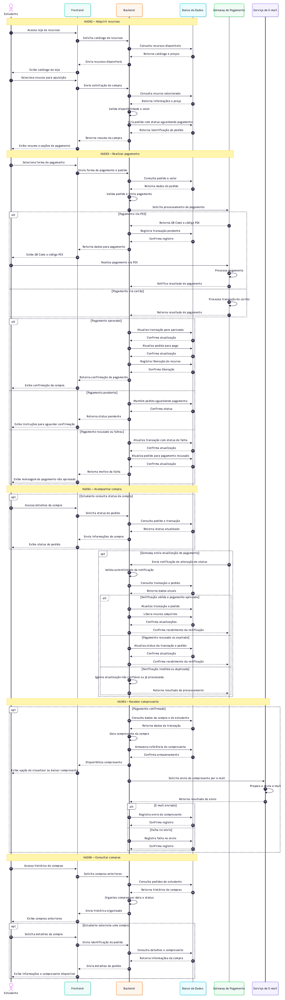](../assets/sequencia/hu-62-66.png)

_Clique na imagem para abrir em tamanho real._

## HU 67-70

- HU067 — Acessar área administrativa
- HU068 — Gerenciar itens da loja
- HU069 — Gerenciar preços
- HU070 — Gerenciar recompensas

PDF original: [`UC 67-70.pdf`](../../Documentos%20de%20Diagramas/DiagramasDeSequencia/UC%2067-70.pdf)

[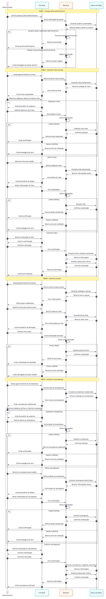](../assets/sequencia/hu-67-70.png)

_Clique na imagem para abrir em tamanho real._

---

[⬅ Voltar para Diagramas](../README.md#3-diagramas) · [Sumário geral](../README.md) · [↑ Topo da página](#)
