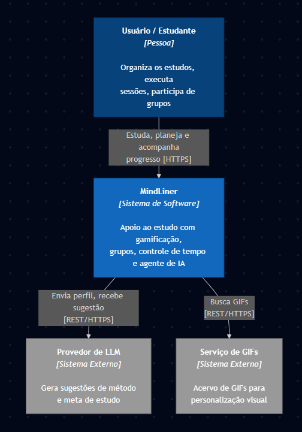
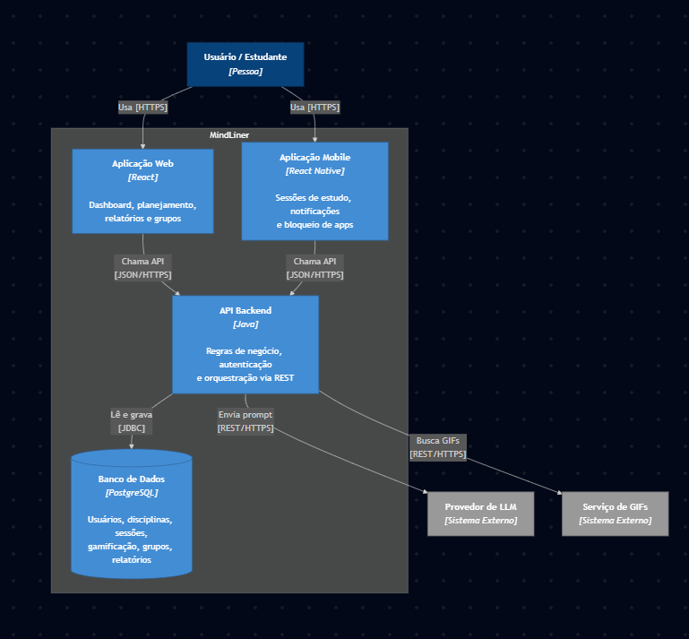
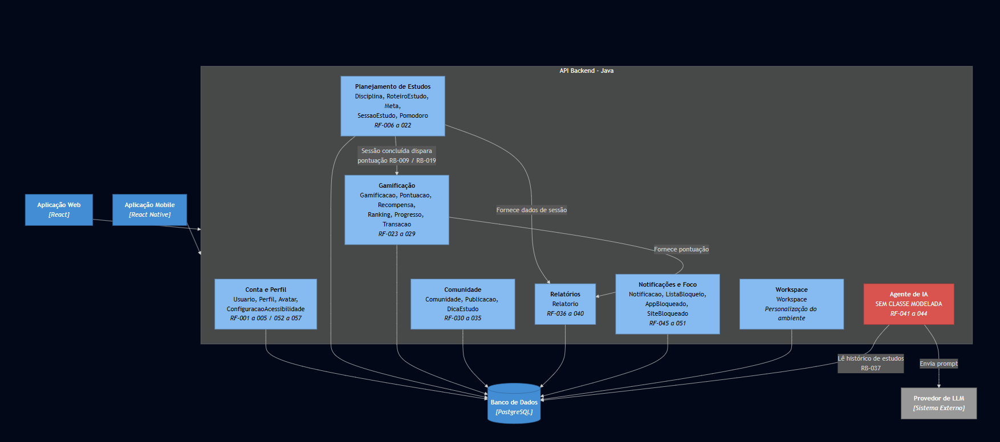

# Documentação de Arquitetura

> Página gerada a partir de [`Documentação de Arquitetura - Encontro 6.docx`](../../Documenta%C3%A7%C3%A3o%20Arquitetura/Documenta%C3%A7%C3%A3o%20de%20Arquitetura%20-%20Encontro%206.docx) para leitura no GitHub. O arquivo original continua sendo a fonte oficial: edite o original e rode `python3 scripts/docs/gerar_docs.py`.

[⬅ Voltar para Arquitetura](../README.md#4-arquitetura) · [Sumário geral](../README.md)

## Sumário

- [Nível 1 — Diagrama de Contexto](#nível-1--diagrama-de-contexto)
  - [Nível 2 — Diagrama de Contêineres](#nível-2--diagrama-de-contêineres)
  - [Nível 3 — Diagrama de Componentes da API](#nível-3--diagrama-de-componentes-da-api)
- [ADR (Architecture Decision Record)](#adr-architecture-decision-record)

### Nível 1 — Diagrama de Contexto

### Nível 2 — Diagrama de Contêineres

### Nível 3 — Diagrama de Componentes da API

## ADR (Architecture Decision Record)

<table>
<thead>
<tr class="header">
<th>Seção</th>
<th>Conteúdo do ADR-001</th>
</tr>
<tr class="odd">
<th><strong>1. Título</strong></th>
<th>ADR-001: Adoção de Java para o desenvolvimento do Backend (API)</th>
</tr>
<tr class="header">
<th><strong>2. Status</strong></th>
<th>Aceito</th>
</tr>
<tr class="odd">
<th><strong>3. Contexto</strong></th>
<th>O aplicativo de estudos exige uma API robusta para gerenciar com segurança a autenticação, processamento de sessões de estudo (incluindo tratamento de queda de conexão), sistema de gamificação, controle de grupos de estudo e integrações de pagamentos. Precisamos definir a linguagem central para a construção dos serviços, avaliando a curva de aprendizado da equipe e a velocidade necessária para a entrega do projeto.</th>
</tr>
<tr class="header">
<th><strong>4. Decisão</strong></th>
<th>Decidimos padronizar a utilização da linguagem Java como a tecnologia principal para o desenvolvimento da API e serviços de backend do aplicativo.</th>
</tr>
<tr class="odd">
<th><strong>5. Consequências</strong></th>
<th>
<strong>Positivas:</strong>

- Redução drástica na curva de aprendizado, visto que Java é a linguagem de maior domínio técnico entre os membros da equipe.

- Facilidade natural em aplicar os conceitos de GRASP e os próprios Padrões de Criação (GoF) exigidos na arquitetura.

- Integração segura e madura com gateways de pagamento e serviços de e-mail mapeados nos requisitos.

<strong>Negativas:</strong>

- Maior verbosidade no código para configurações iniciais em comparação com linguagens de script.

- Consumo de recursos de infraestrutura (memória) marginalmente maior, o que é um trade-off plenamente aceitável dado o ganho de produtividade da equipe.
</th>
</tr>
</thead>
<tbody>
</tbody>
</table>

<table>
<thead>
<tr class="header">
<th><strong>Seção</strong></th>
<th><strong>Conteúdo do ADR-002</strong></th>
</tr>
<tr class="odd">
<th><strong>1. Título</strong></th>
<th>ADR-002: Adoção de React Native para o desenvolvimento Frontend Mobile</th>
</tr>
<tr class="header">
<th><strong>2. Status</strong></th>
<th>Aceito</th>
</tr>
<tr class="odd">
<th><strong>3. Contexto</strong></th>
<th>O aplicativo de estudos será distribuído para um público variado, precisando atender simultaneamente usuários de smartphones Android e iOS (iPhone). Precisamos definir o framework de interface móvel considerando a capacidade técnica da equipe e a necessidade de não duplicar o esforço de engenharia, evitando escrever duas bases de código separadas (ex: Swift para iOS e Kotlin para Android).</th>
</tr>
<tr class="header">
<th><strong>4. Decisão</strong></th>
<th>Decidimos utilizar React Native, juntamente com o ecossistema Expo, como a tecnologia oficial para a construção de todo o aplicativo mobile (Frontend).</th>
</tr>
<tr class="odd">
<th><strong>5. Consequências</strong></th>
<th>
<strong>Positivas:</strong>

- O React Native permite compilar o aplicativo para Android e iOS a partir de uma única base de código, cortando o tempo de desenvolvimento pela metade.

- A equipe já possui um bom domínio sobre a stack do React Native e frontend, o que elimina a curva de aprendizado de uma nova linguagem e garante uma entrega mais rápida.

<strong>Negativas:</strong>

- Como o aplicativo possui funcionalidades profundas no sistema operacional (como a interceptação e bloqueio de outros aplicativos do Modo Foco), essas partes muito específicas poderão exigir a criação de módulos nativos integrados ao React Native, adicionando uma leve camada de complexidade na comunicação das interfaces.
</th>
</tr>
</thead>
<tbody>
</tbody>
</table>

<table>
<thead>
<tr class="header">
<th><strong>Seção</strong></th>
<th><strong>Conteúdo do ADR-003</strong></th>
</tr>
<tr class="odd">
<th><strong>1. Título</strong></th>
<th>ADR-003: Adoção do PostgreSQL como Banco de Dados Principal</th>
</tr>
<tr class="header">
<th><strong>2. Status</strong></th>
<th>Aceito</th>
</tr>
<tr class="odd">
<th><strong>3. Contexto</strong></th>
<th>O aplicativo precisa armazenar informações altamente interligadas, como perfis de usuários, registros de tempo de estudo, saldos de moedas virtuais, grupos e histórico de pagamentos. Embora soluções baseadas em documentos como o MongoDB ofereçam bastante flexibilidade no desenvolvimento e parte da equipe já tenha afinidade com essa tecnologia em outros ambientes, a forte necessidade de integridade relacional para dados transacionais e acadêmicos exige um banco de dados SQL. Precisamos de uma tecnologia que seja simples o suficiente para cobrir o escopo inicial de forma direta, sem adicionar complexidade excessiva de infraestrutura.</th>
</tr>
<tr class="header">
<th><strong>4. Decisão</strong></th>
<th>Decidimos utilizar o PostgreSQL como o banco de dados oficial para o armazenamento e gerenciamento das informações do sistema.</th>
</tr>
<tr class="odd">
<th><strong>5. Consequências</strong></th>
<th>
<strong>Positivas:</strong>

- É uma solução simples de configurar inicialmente, mas que escala muito bem e atende perfeitamente ao tamanho atual do projeto.

- Garante a consistência dos dados financeiros (gamificação e compras) e do histórico acadêmico por meio de relacionamentos estruturados.

- Possui excelente maturidade e integração natural com o ecossistema Java (definido no ADR-001).

<strong>Negativas:</strong>

- Exige um planejamento rigoroso da modelagem de tabelas e uso de migrações (esquemas rígidos).

- A equipe precisará lidar com uma flexibilidade menor para mudanças rápidas no formato dos dados durante o desenvolvimento, em comparação com a estrutura livre de documentos NoSQL.
</th>
</tr>
</thead>
<tbody>
</tbody>
</table>

---

[⬅ Voltar para Arquitetura](../README.md#4-arquitetura) · [Sumário geral](../README.md) · [↑ Topo da página](#)
