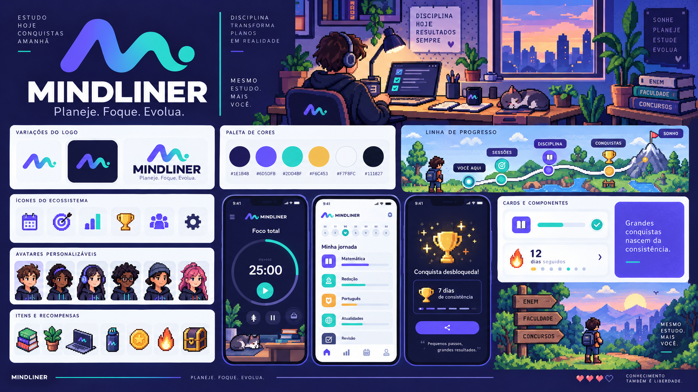

# Pesquisa de Branding

> Página gerada a partir de [`Pesquisa de Branding.docx`](../../Design%20-%20UI/Pesquisa%20de%20Branding.docx) para leitura no GitHub. O arquivo original continua sendo a fonte oficial: edite o original e rode `python3 scripts/docs/gerar_docs.py`.

[⬅ Voltar ao sumário](../README.md)

## Sumário

- [1. Síntese Estratégica e Diretrizes de Marca](#1-síntese-estratégica-e-diretrizes-de-marca)
  - [1.1 Resumo executivo](#11-resumo-executivo)
  - [1.2 Núcleo da marca](#12-núcleo-da-marca)
  - [Valores](#valores)
- [2. Público-Alvo](#2-público-alvo)
  - [Segmentos prioritários](#segmentos-prioritários)
  - [Necessidades compartilhadas](#necessidades-compartilhadas)
- [3. Posicionamento e Proposta de Valor](#3-posicionamento-e-proposta-de-valor)
  - [Categoria](#categoria)
  - [Declaração de posicionamento](#declaração-de-posicionamento)
  - [Pilares de marca](#pilares-de-marca)
  - [Assinatura recomendada](#assinatura-recomendada)
- [4. Aprendizados de Benchmarking](#4-aprendizados-de-benchmarking)
- [5. Identidade Verbal](#5-identidade-verbal)
  - [Tom de voz](#tom-de-voz)
  - [Exemplos de mensagens](#exemplos-de-mensagens)
- [6. Estratégia de Gamificação](#6-estratégia-de-gamificação)
  - [Ciclo principal](#ciclo-principal)
  - [Economia e progressão](#economia-e-progressão)
  - [Princípios éticos](#princípios-éticos)
- [7. Direção da Identidade Visual](#7-direção-da-identidade-visual)
  - [Conceito — Linha de Progresso](#conceito--linha-de-progresso)
  - [Logotipo](#logotipo)
  - [Paleta preliminar](#paleta-preliminar)
  - [Tipografia e sistema gráfico](#tipografia-e-sistema-gráfico)
  - [Personagem-companheiro](#personagem-companheiro)
- [8. Moodboard Conceitual](#8-moodboard-conceitual)
- [9. Direcionamento do MVP no Figma](#9-direcionamento-do-mvp-no-figma)
  - [Objetivo do protótipo](#objetivo-do-protótipo)
  - [Fundações do design system](#fundações-do-design-system)
  - [Telas prioritárias](#telas-prioritárias)
  - [Escopo posterior](#escopo-posterior)
- [10. Hipóteses e Validação](#10-hipóteses-e-validação)
  - [Questões de validação](#questões-de-validação)
- [11. Fontes e Referências](#11-fontes-e-referências)
- [Conclusão](#conclusão)

# Pesquisa de Branding

Este documento consolida a pesquisa de branding do MindLiner e orienta o posicionamento, a identidade verbal, a linguagem visual gamificada e o desenvolvimento do MVP no Figma.

## 1. Síntese Estratégica e Diretrizes de Marca

Esta seção consolida as decisões tomadas após a leitura da documentação do MindLiner e funciona como base prática para a identidade visual e o desenvolvimento do MVP no Figma.

### 1.1 Resumo executivo

O MindLiner deve ser apresentado como uma plataforma brasileira de execução de estudos. Mais do que um timer ou agenda, o produto ajuda o usuário a planejar, começar, manter o foco, registrar o esforço e retomar a rotina após interrupções. A gamificação funciona como uma camada de motivação e visualização do progresso, e não como um jogo separado.

A direção recomendada é a Linha de Progresso: cada sessão concluída faz o usuário avançar por caminhos, nós, checkpoints, níveis e conquistas. A identidade principal deve ser madura, tecnológica e acolhedora; a camada gamificada deve ser personalizável e opcional.

### 1.2 Núcleo da marca

- Propósito: ajudar pessoas a transformar objetivos de estudo em progresso consistente, compreensível e sustentável.

- Missão: unir planejamento, técnicas de estudo, foco, registro e motivação em uma plataforma acessível.

- Visão: tornar-se uma das principais plataformas brasileiras de organização e execução de estudos.

- Promessa: transformar cada sessão de estudo em avanço perceptível.

- Arquétipo principal — Guia: organiza caminhos, reduz o caos e revela o próximo passo.

- Arquétipo secundário — Explorador: transforma metas em uma jornada de descoberta e evolução.

### Valores

- Progresso real: recompensar esforço e consistência, não apenas resultados finais.

- Autonomia: permitir técnicas, metas, aparência e intensidade de gamificação ajustáveis.

- Clareza: mostrar o próximo passo sem sobrecarregar.

- Acolhimento: tratar interrupções como parte da jornada e facilitar a retomada.

- Confiança: proteger dados, explicar regras e evitar promessas irreais.

- Acessibilidade: considerar diferentes capacidades e contextos de uso.

## 2. Público-Alvo

A marca deve atender um público amplo unido por uma necessidade comum: pessoas com objetivos acadêmicos importantes que precisam organizar grandes volumes de conteúdo, sustentar o foco e perceber evolução.

### Segmentos prioritários

- ENEM e vestibulares: organização de matérias extensas, lacunas e preparação até a prova.

- Universitários: conciliação de disciplinas, trabalhos, avaliações e projetos.

- Concurseiros: manutenção de ciclos longos e comparação de desempenho por matéria.

### Necessidades compartilhadas

- Saber o que estudar agora.

- Reduzir a dificuldade de começar.

- Controlar o tempo e as distrações.

- Visualizar progresso por disciplina e objetivo.

- Retomar a rotina depois de falhas ou interrupções.

- Receber motivação sem pressão, culpa ou competição obrigatória.

A linguagem visual deve funcionar principalmente para um público adulto-jovem, aproximadamente dos 16 aos 35 anos, sem excluir outras idades. Preferências por anime, jogos, música ou pixel art são hipóteses de segmentos específicos e não devem orientar toda a marca antes de validação.

## 3. Posicionamento e Proposta de Valor

### Categoria

Plataforma gamificada de planejamento, foco e evolução nos estudos.

### Declaração de posicionamento

Para estudantes do ENEM, universitários e concurseiros que precisam transformar objetivos extensos em ações possíveis, o MindLiner é uma plataforma brasileira de execução de estudos que organiza o próximo passo, protege o tempo de foco e converte esforço real em progresso visível.

### Pilares de marca

- Direção: organizar prioridades e revelar o próximo passo.

- Foco: apoiar a execução com técnicas adaptáveis e controle de distrações.

- Continuidade: preservar o esforço e facilitar a retomada.

- Evolução: mostrar crescimento, conquistas e domínio por matéria.

- Pertencimento: permitir grupos e desafios de forma opcional e segura.

### Assinatura recomendada

Planeje. Foque. Evolua.

## 4. Aprendizados de Benchmarking

- YPT demonstra a força do foco social, dos grupos, rankings e estatísticas. A referência para o MindLiner é gerar pertencimento sem tornar a comparação obrigatória.

- Study Bunny comprova o apelo do ciclo estudar, ganhar moedas e personalizar um personagem, mas também mostra o risco de restringir a identificação de públicos mais velhos quando toda a marca é excessivamente fofa.

- Habitica demonstra a profundidade possível de avatares, experiência, moedas e recompensas. Sua combinação de interface funcional com elementos 2D e pixel art serve como referência de linguagem, sem copiar personagens, telas ou estrutura. No MindLiner, o estudo permanece em primeiro plano e a pixel art fica concentrada na ambientação, na personalização e nas recompensas.

- Forest transforma minutos de foco em crescimento visível por meio de uma metáfora única. Essa simplicidade inspira a Linha de Progresso.

- Tudy, NoEstudo e Aprovado reforçam a necessidade de localização brasileira, planejamento e métricas. A oportunidade do MindLiner está na integração entre planejamento, execução e retomada.

O espaço competitivo recomendado é o de uma plataforma mais orientada que um timer, mais simples para começar que uma ferramenta generalista e mais madura que experiências centradas apenas em personagens fofos.

## 5. Identidade Verbal

### Tom de voz

- Claro e direto: frases curtas, ações concretas e próximo passo evidente.

- Motivador: reconhecimento do esforço sem prometer aprovação ou desempenho garantido.

- Acolhedor: incentivo à retomada sem culpa.

- Inteligente: explicação das recomendações e ajustes feitos pela IA.

- Jovem e inclusivo: contemporâneo, mas sem excesso de gírias.

### Exemplos de mensagens

- Início: “Qual é o próximo passo da sua jornada?”

- Sessão concluída: “Mais uma etapa avançada. Seu esforço já aparece na trilha.”

- Retomada: “Você não perdeu o caminho. Vamos continuar do ponto possível.”

- Conquista: “Consistência desbloqueada: você estudou em três dias diferentes nesta semana.”

- Modo foco: “Esta distração pode esperar? Volte para sua sessão ou encerre salvando o tempo estudado.”

Evitar linguagem de culpa, promessas de aprovação, competição global obrigatória, infantilização e humor que diminua a dificuldade do usuário.

## 6. Estratégia de Gamificação

A gamificação deve revelar o valor do estudo, e não substituir sua motivação. O usuário realiza uma ação acadêmica real, recebe feedback imediato, avança em uma trilha persistente e escolhe como utilizar a recompensa.

### Ciclo principal

- Escolher uma meta ou disciplina.

- Iniciar uma sessão com a técnica adequada.

- Receber feedback durante e ao final do foco.

- Avançar na Linha de Progresso.

- Ganhar experiência, moedas ou uma conquista.

- Personalizar personagem, ambiente ou interface.

- Visualizar o próximo passo recomendado.

### Economia e progressão

- Experiência ou pontos representam evolução permanente e não são gastos.

- Moedas são utilizadas em itens cosméticos e precisam ter regras transparentes.

- Conquistas registram marcos significativos.

- Sequências valorizam consistência, mas devem permitir recuperação ou dias de proteção.

- Rankings devem ser opcionais e preferencialmente limitados a amigos, grupos ou objetivos comparáveis.

### Princípios éticos

- Não utilizar medo de perder todo o progresso.

- Não usar o personagem para provocar culpa.

- Explicar pontos, moedas, rankings e recompensas.

- Separar claramente moedas conquistadas de pagamentos em dinheiro real.

- Permitir reduzir animações, sons, notificações e intensidade da gamificação.

## 7. Direção da Identidade Visual

### Conceito — Linha de Progresso

A linha representa pensamento, caminho, continuidade e conexão. Ela pode formar o símbolo da marca, ligar etapas de um plano, indicar evolução por disciplina e acompanhar o personagem. O sistema visual deve fazer o usuário sentir que seu esforço deixa um rastro positivo.

### Logotipo

Explorar um símbolo abstrato construído por uma linha contínua, sugerindo caminho, avanço, conexão e, de forma sutil, a letra M. O logotipo não deve depender do personagem.

### Paleta preliminar

- Índigo profundo — \#1E1B4B: foco, confiança e base da marca.

- Violeta progressivo — \#6D5DFB: tecnologia, movimento e evolução.

- Turquesa — \#2DD4BF: ação, clareza e estados positivos.

- Dourado — \#F6C453: recompensa e conquista, usado com moderação.

- Off-white — \#F7F8FC: leveza e superfícies claras.

- Grafite — \#111827: leitura, contraste e modo escuro.

### Tipografia e sistema gráfico

Usar tipografia sem serifa geométrica nos títulos e uma fonte de alta legibilidade na interface. A base visual será contemporânea, limpa e bidimensional, com linhas contínuas, nós, checkpoints, ondas e conexões. A pixel art será aplicada como uma camada seletiva de gamificação — aproximadamente 30% da linguagem — em avatares, recompensas, pequenos cenários e marcos da jornada. A interface principal permanece moderna e legível, evitando que o produto pareça infantil ou visualmente carregado. A escolha final das fontes deverá considerar licença, suporte a português, números do timer e consistência entre web e mobile.

### Personagem-companheiro

O personagem será um avatar 2D em pixel art, secundário, modular, diverso e personalizável. Poderá acompanhar sessões, aparecer em pequenos cenários de estudo, comemorar conquistas e utilizar itens cosméticos. Não deverá dominar o logotipo, substituir o conteúdo acadêmico nem impedir uma experiência discreta para concurseiros e usuários que preferem uma interface séria.

## 8. Moodboard Conceitual

O moodboard adota uma base visual 2D contemporânea com elementos seletivos de pixel art. A interface permanece limpa e legível, enquanto avatares, itens, recompensas, cenários e checkpoints comunicam a dimensão gamificada. A Linha de Progresso assume a forma de uma jornada visual que conecta sessões, disciplinas, conquistas e objetivos de longo prazo para estudantes do ENEM, universitários e concurseiros.

Figura 1 — Moodboard conceitual da direção 2D + pixel art do MindLiner. A Linha de Progresso funciona como mapa da jornada, enquanto avatares e recompensas ocupam uma camada secundária. Exploração para orientar o MVP; não representa logotipo ou interface final.

## 9. Direcionamento do MVP no Figma

### Objetivo do protótipo

Validar se o usuário entende a proposta, configura um objetivo, inicia uma sessão, conclui o foco e percebe evolução sem se perder entre funcionalidades.

### Fundações do design system

- Variáveis de cor para marca, temas claro e escuro, disciplinas, estados e recompensas.

- Tipografia responsiva para títulos, corpo, métricas e timer.

- Escala de espaçamento, raios, sombras e grid para mobile e web.

- Componentes de botão, campo, cartão, navegação, modal, progresso, badge e feedback.

- Estados de carregamento, vazio, erro, sucesso, pausa e sessão interrompida.

### Telas prioritárias

- Onboarding e definição do objetivo de estudo.

- Página inicial com próximo passo e resumo da jornada.

- Cadastro de disciplinas, metas e plano de estudos.

- Seleção de técnica e configuração da sessão.

- Timer ou cronômetro em modo foco.

- Conclusão da sessão com registro, pontos e avanço na trilha.

- Progresso por disciplina e histórico.

- Perfil e personalização básica do personagem.

### Escopo posterior

Grupos avançados, ranking completo, IA adaptativa, pagamentos, loja extensa e bloqueio profundo de aplicativos devem ser desenvolvidos depois que o ciclo principal estiver compreensível e validado.

## 10. Hipóteses e Validação

A identidade e o protótipo devem ser testados com participantes dos três segmentos prioritários. Uma primeira rodada pode envolver de cinco a oito pessoas com rotinas e níveis de familiaridade diferentes.

### Questões de validação

- A marca parece confiável e adequada para estudo sério?

- A gamificação motiva sem parecer infantil?

- A Linha de Progresso é compreendida sem explicação longa?

- O próximo passo está evidente na página inicial?

- Pontos e moedas possuem funções distintas e compreensíveis?

- O personagem agrega valor ou distrai?

- A pessoa consegue iniciar e concluir uma sessão sem ajuda?

## 11. Fontes e Referências

- Documentação interna do MindLiner: escopo, requisitos, casos de uso, pesquisa de mercado, análise SWOT e documento de abertura.

- [YPT — Google Play](https://play.google.com/store/apps/details?hl=en_US&id=com.pallo.passiontimerscoped)

- [Study Bunny — App Store](https://apps.apple.com/us/app/study-bunny-focus-timer/id1478345385)

- [Habitica — site oficial](https://habitica.com/)

- [Forest — site oficial](https://forestapp.cc/)

- [Duolingo Design — artigos de produto e design](https://blog.duolingo.com/hub/design/)

- [ACM — pesquisa sobre padrões de pressão em experiências gamificadas](https://dl.acm.org/doi/10.1145/3773077.3806127)

## Conclusão

A identidade mais promissora combina uma base madura e tecnológica com uma gamificação flexível. A Linha de Progresso oferece uma metáfora capaz de conectar marca, interface, evolução, personagem e comunicação. Essa direção orientará o MVP no Figma e deverá ser refinada após testes com estudantes do ENEM, universitários e concurseiros.
