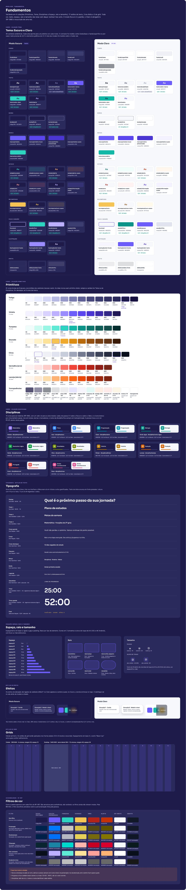
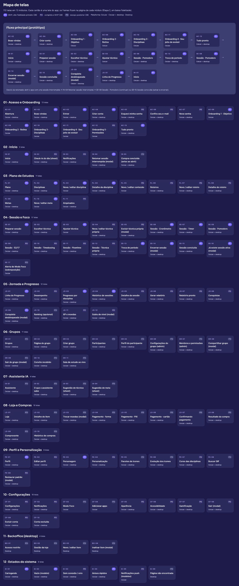
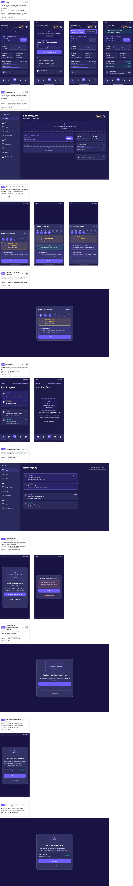
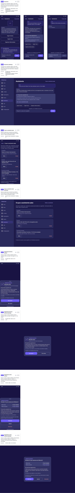
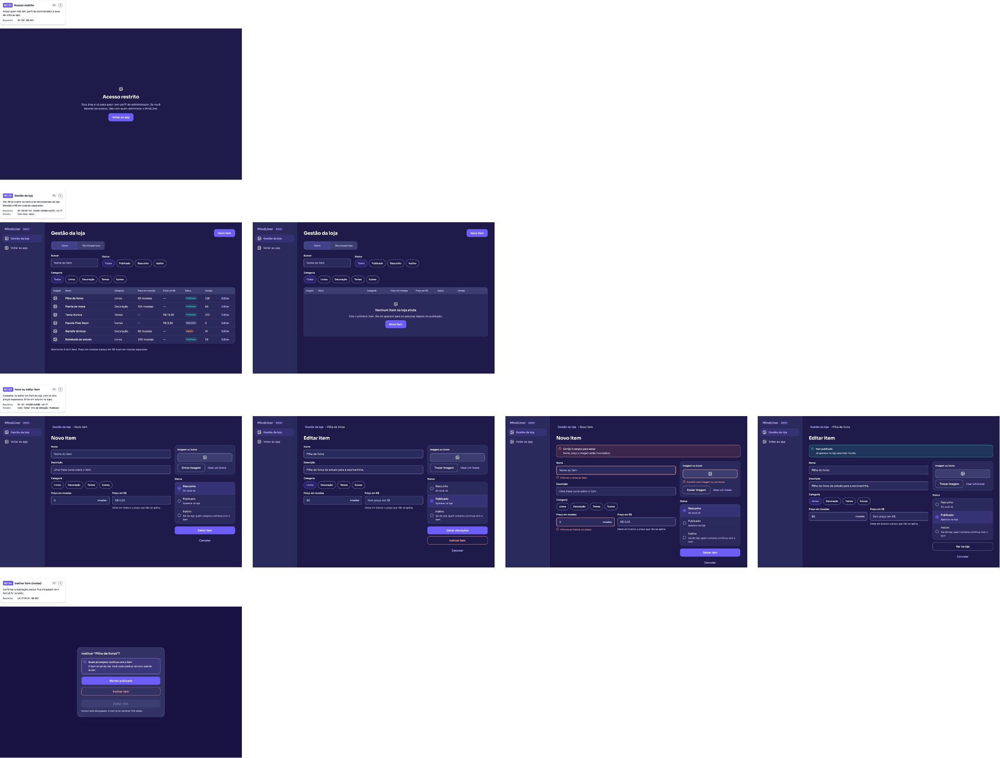
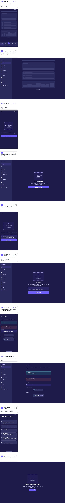

# Wireframes

> Página gerada a partir de [`Wireframes/`](../../Design%20-%20UI/Wireframes) para leitura no GitHub. O arquivo original continua sendo a fonte oficial: edite o original e rode `python3 scripts/docs/gerar_docs.py`.
>
> Os PDFs dos wireframes são grandes (até 20 MB) e o GitHub nem sempre consegue abri-los. Aqui ficam prévias em imagem; para os detalhes, use o PDF ou o [Figma](../../Design%20-%20UI/README.md).

[⬅ Voltar ao sumário](../README.md)

## Sumário

- [Fundamentos](#fundamentos)
- [Mapa de Telas](#mapa-de-telas)
- [01 · Acesso e Onboarding](#01--acesso-e-onboarding)
- [02 · Início](#02--início)
- [03 · Plano de Estudos](#03--plano-de-estudos)
- [04 · Sessão e Foco](#04--sessão-e-foco)
- [05 · Jornada e Progresso](#05--jornada-e-progresso)
- [06 · Grupos](#06--grupos)
- [07 · Assistente IA](#07--assistente-ia)
- [08 · Loja e Compras](#08--loja-e-compras)
- [09 · Perfil e Personalização](#09--perfil-e-personalização)
- [10 · Configurações](#10--configurações)
- [11 · Backoffice (desktop)](#11--backoffice-desktop)
- [12 · Estados do sistema](#12--estados-do-sistema)

## Fundamentos

PDF original: [`Fundamentos.pdf`](../../Design%20-%20UI/Wireframes/Fundamentos.pdf)

_Clique na imagem para abrir em tamanho real._

## Mapa de Telas

PDF original: [`Mapa de Telas.pdf`](../../Design%20-%20UI/Wireframes/Mapa%20de%20Telas.pdf)

_Clique na imagem para abrir em tamanho real._

## 01 · Acesso e Onboarding

PDF original: [`01 · Acesso e Onboarding.pdf`](../../Design%20-%20UI/Wireframes/01%20%C2%B7%20Acesso%20e%20Onboarding.pdf)

_Clique na imagem para abrir em tamanho real._

## 02 · Início

PDF original: [`02 · Início.pdf`](../../Design%20-%20UI/Wireframes/02%20%C2%B7%20In%C3%ADcio.pdf)

_Clique na imagem para abrir em tamanho real._

## 03 · Plano de Estudos

PDF original: [`03 · Plano de Estudos.pdf`](../../Design%20-%20UI/Wireframes/03%20%C2%B7%20Plano%20de%20Estudos.pdf)

_Clique na imagem para abrir em tamanho real._

## 04 · Sessão e Foco

PDF original: [`04 · Sessão e Foco.pdf`](../../Design%20-%20UI/Wireframes/04%20%C2%B7%20Sess%C3%A3o%20e%20Foco.pdf)

_Clique na imagem para abrir em tamanho real._

## 05 · Jornada e Progresso

PDF original: [`05 · Jornada e Progresso.pdf`](../../Design%20-%20UI/Wireframes/05%20%C2%B7%20Jornada%20e%20Progresso.pdf)

_Clique na imagem para abrir em tamanho real._

## 06 · Grupos

PDF original: [`06 · Grupos.pdf`](../../Design%20-%20UI/Wireframes/06%20%C2%B7%20Grupos.pdf)

_Clique na imagem para abrir em tamanho real._

## 07 · Assistente IA

PDF original: [`07 · Assistente IA.pdf`](../../Design%20-%20UI/Wireframes/07%20%C2%B7%20Assistente%20IA.pdf)

_Clique na imagem para abrir em tamanho real._

## 08 · Loja e Compras

PDF original: [`08 · Loja e Compras.pdf`](../../Design%20-%20UI/Wireframes/08%20%C2%B7%20Loja%20e%20Compras.pdf)

_Clique na imagem para abrir em tamanho real._

## 09 · Perfil e Personalização

PDF original: [`09 · Perfil e Personalização.pdf`](../../Design%20-%20UI/Wireframes/09%20%C2%B7%20Perfil%20e%20Personaliza%C3%A7%C3%A3o.pdf)

_Clique na imagem para abrir em tamanho real._

## 10 · Configurações

PDF original: [`10 · Configurações.pdf`](../../Design%20-%20UI/Wireframes/10%20%C2%B7%20Configura%C3%A7%C3%B5es.pdf)

_Clique na imagem para abrir em tamanho real._

## 11 · Backoffice (desktop)

PDF original: [`11 · Backoffice (desktop).pdf`](../../Design%20-%20UI/Wireframes/11%20%C2%B7%20Backoffice%20%28desktop%29.pdf)

_Clique na imagem para abrir em tamanho real._

## 12 · Estados do sistema

PDF original: [`12 · Estados do sistema.pdf`](../../Design%20-%20UI/Wireframes/12%20%C2%B7%20Estados%20do%20sistema.pdf)

_Clique na imagem para abrir em tamanho real._
